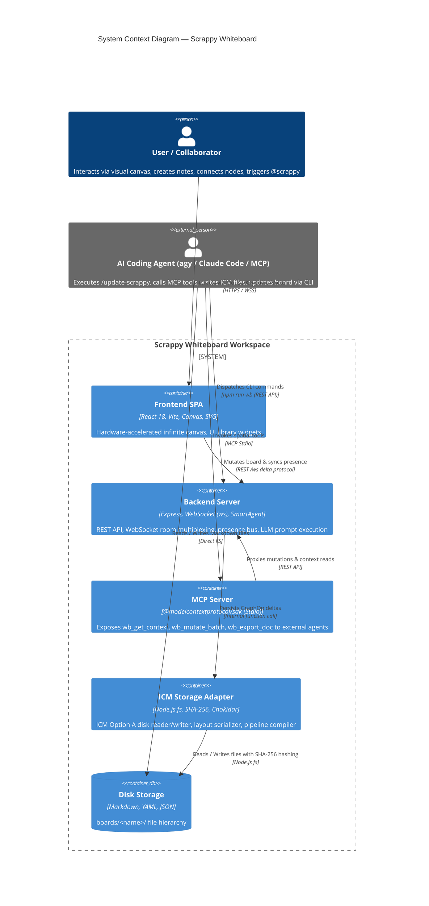
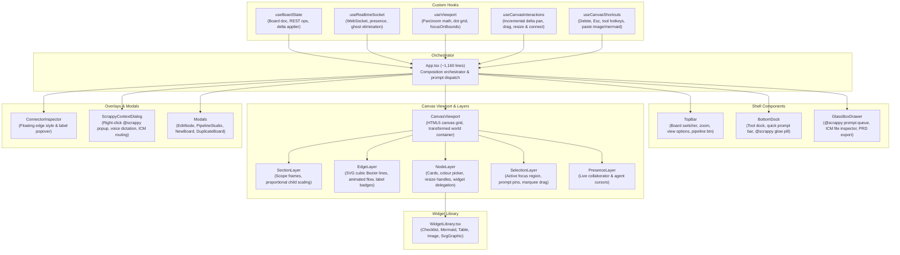
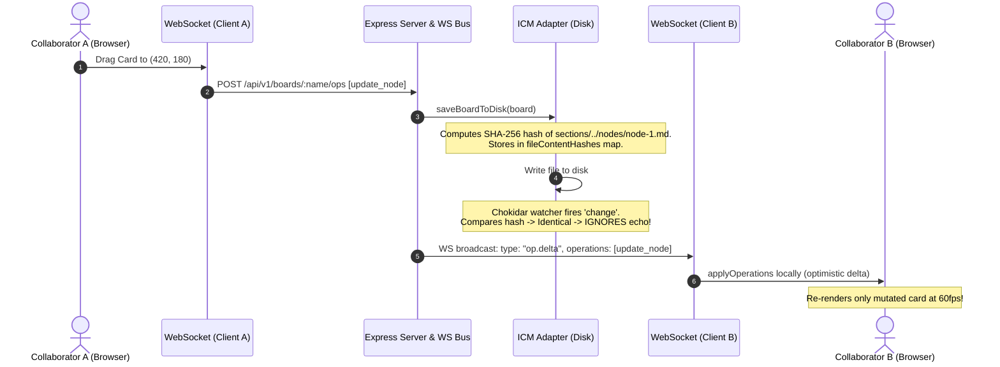
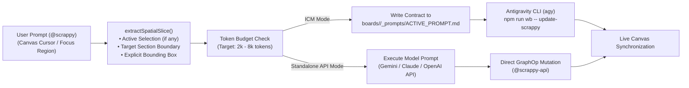
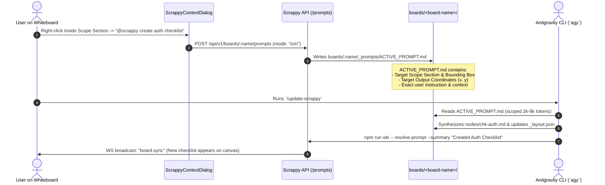
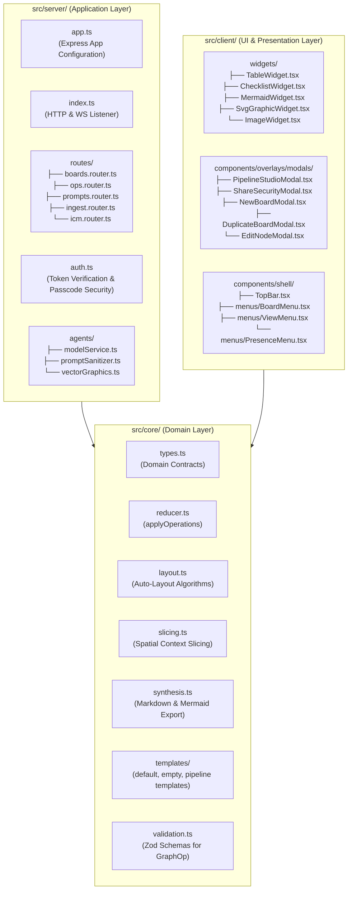

# Scrappy Whiteboard — Architecture & Context Map

> **Audience:** Human Engineers, Senior Architects, and Autonomous AI Coding Agents (`agy`, Claude Code, Cursor, MCP).  
> **Status:** Production-Ready (P0 Security Patched & P1 Modularized).

---

## Component Documentation Map (Agent & Developer Routing)

Use this document as the overarching system map, and load the specific component guide below when working on a targeted area:

| Component Area | Detailed Guide | Scope & Primary Source Files |
| :--- | :--- | :--- |
| **API, CLI & MCP (DX)** | [docs/API_AND_DX.md](./docs/API_AND_DX.md) | REST API v1 endpoints (`src/server/index.ts`), `npm run wb` CLI (`src/cli/wb.ts`), MCP stdio tools (`src/mcp/server.ts`), webhooks, SDK/OpenAPI roadmap |
| **Real-Time & WebSockets** | [docs/REALTIME_AND_WEBSOCKETS.md](./docs/REALTIME_AND_WEBSOCKETS.md) | `RealtimeBus` (`/ws`), `AblyFederationBridge`, capability tokens, message envelopes, `useRealtimeSocket`, Follow Teammate, concurrency roadmap |
| **Frontend UI & Canvas** | [docs/FRONTEND_UI.md](./docs/FRONTEND_UI.md) | React SPA (`src/client/App.tsx`), viewport/panning/placement (`useViewport`, `useCanvasInteractions`, `geometry.ts`), canvas layers, overlays, `WidgetLibrary.tsx` |
| **Core Graph Engine** | [docs/CORE_ENGINE.md](./docs/CORE_ENGINE.md) | Domain types (`src/core/types.ts`), `applyOperations`, auto-layout, spatial slicing, Markdown/Mermaid synthesis, slug security, `engine.ts` decomposition plan |
| **ICM Storage & AI Agents** | [docs/ICM_AND_AGENTS.md](./docs/ICM_AND_AGENTS.md) | ICM Option A disk layout, `ICMAdapter` (`src/icm/adapter.ts`), `ICMArchitect` (`src/icm/architect.ts`), `SmartAgent` LLM runner (`src/server/smartAgent.ts`) |

---

## 1. System Overview & Core Philosophy

**Scrappy Whiteboard** bridges visual human spatial reasoning and structured AI agent workflows. It pairs an infinite, hardware-accelerated **React + HTML5 Canvas + SVG** whiteboard with **Interpretable Context Methodology (ICM) Option A (Node-per-File)** disk persistence.

```
       HUMAN DEVELOPER                               AI CODING AGENT
   ┌──────────────────────┐                       ┌──────────────────────┐
   │ Interactive Canvas   │                       │ Antigravity CLI (agy)│
   │  - Spatial Cards     │                       │  - /update-scrappy   │
   │  - Scope Sections    │                       │  - npm run wb        │
   │  - Drag Connectors   │                       │  - 2k-8k token files │
   └──────────┬───────────┘                       └──────────┬───────────┘
              │ Visual Interactions                          │ Markdown Ops
              ▼                                              ▼
   ┌─────────────────────────────────────────────────────────────────────┐
   │                       Scrappy Whiteboard Engine                     │
   │   (Deterministic SHA-256 Hashing · WebSocket Deltas · ICM Storage)   │
   └──────────────────────────────────┬──────────────────────────────────┘
                                      │
                                      ▼
                        ┌───────────────────────────┐
                        │   boards/<board-name>/    │
                        │   ├── CONTEXT.md          │
                        │   ├── BOARD_MAP.md        │
                        │   ├── _layout.json        │
                        │   ├── _prompts/           │
                        │   └── sections/<slug>/    │
                        └───────────────────────────┘
```

### Core Design Tenets
1. **ICM Option A (Node-per-file):** Every visual card maps directly to an isolated, token-efficient Markdown file (`sections/<slug>/nodes/<id>.md`) with strict YAML frontmatter. Agents read and write 200–500 token files rather than massive multi-megabyte JSON blobs.
2. **Deterministic Content Hashing:** The storage layer tracks SHA-256 hashes of all written files. Chokidar file watcher echoes from the server's own writes are ignored, while external agent modifications (via CLI or editor) are immediately ingested without race conditions or arbitrary millisecond timeouts.
3. **Delta WebSocket Protocol:** Real-time collaboration uses lightweight `op.delta` payloads containing only mutated `GraphOp[]` arrays, reducing peer bandwidth consumption by >95% compared to full board snapshot broadcasts.
4. **Agent Safety & Token Discipline:** Right-click `@scrappy` prompts enforce spatial bounding boxes and Scope Sections, ensuring AI reasoning operates inside strict token limits (2k–8k tokens).

---

## 2. System Architecture Diagrams

### 2.1 C4 Container Diagram



---

### 2.2 Client Component Architecture (Modularized P1)

Following the P1 refactoring, the monolithic 4,917-line `App.tsx` has been decomposed into high-cohesion, isolated hooks and components:



---

### 2.3 Real-Time Delta Data Flow



---

### 2.4 AI Agent (`@scrappy`) Interaction Lifecycle & Token Discipline

Scrappy enforces strict **ICM Token Discipline (2k–8k tokens)** by extracting a scoped spatial slice before routing prompts to either **ICM Mode** (human-in-the-loop via `ACTIVE_PROMPT.md`) or **Standalone API Mode** (direct LLM execution via `smartAgent.ts`):





---

## 3. Directory & File Reference Map

```
/Users/munron/scrappy/
├── boards/                           # ICM Option A board folders
│   └── <board-name>/
│       ├── CONTEXT.md                # Top-level ICM routing file (RinDig/icm-architect)
│       ├── BOARD_MAP.md              # Human/agent readable board summary
│       ├── _layout.json              # Spatial positions, viewport state, edge definitions
│       ├── _prompts/
│       │   └── ACTIVE_PROMPT.md      # Contract for /update-scrappy execution
│       └── sections/                 # Scope Sections (stage frames)
│           └── <section-slug>/
│               ├── _section.json     # Section metadata and bounding box
│               └── nodes/            # Discrete Markdown cards
│                   └── <node-id>.md  # Frontmatter + content
│
├── src/
│   ├── client/                       # Frontend SPA (React + TypeScript)
│   │   ├── components/
│   │   │   ├── canvas/
│   │   │   │   ├── CanvasViewport.tsx   # Canvas container & dot grid background
│   │   │   │   ├── CornerHandles.tsx    # Reusable 4-corner resize handles
│   │   │   │   ├── EdgeLayer.tsx        # SVG Bezier directed connectors
│   │   │   │   ├── NodeLayer.tsx        # Interactive cards & widget delegator
│   │   │   │   ├── PresenceLayer.tsx    # Real-time peer cursors, colored pointers & status
│   │   │   │   ├── SectionLayer.tsx     # Scope Section frames & header drag
│   │   │   │   └── SelectionLayer.tsx   # Marquee box, focus highlight & pins
│   │   │   ├── overlays/
│   │   │   │   ├── modals/                 # Decomposed modal dialogs (EditNode, PipelineStudio, NewBoard, Duplicate, ShareSecurity, PasscodePrompt)
│   │   │   │   ├── ConnectorInspector.tsx  # Edge style/label popover
│   │   │   │   ├── Modals.tsx              # Backward-compatible barrel re-exporting ./modals/*
│   │   │   │   └── ScrappyContextDialog.tsx # Right-click @scrappy popup & voice
│   │   │   └── shell/
│   │   │       ├── BottomDock.tsx       # Floating tool palette & quick prompt bar
│   │   │       ├── GlassBoxDrawer.tsx   # Collapsible prompt queue & file tree
│   │   │       └── TopBar.tsx           # Navigation, board switcher, collaborator avatars & follow mode
│   │   ├── hooks/
│   │   │   ├── useBoardState.ts         # Board persistence & delta applier
│   │   │   ├── useCanvasInteractions.ts # Drag, resize & connect state machines
│   │   │   ├── useCanvasShortcuts.ts    # Keyboard hotkeys & clipboard paste
│   │   │   ├── useRealtimeSocket.ts     # Multi-user WebSocket & Ably client, presence, follow camera
│   │   │   └── useViewport.ts           # Zoom/pan math & dot grid drawing
│   │   ├── utils/
│   │   │   ├── geometry.ts              # Resize bounds math, Bezier & nearest-space placement
│   │   │   └── geometry.test.ts         # Unit tests for geometry & smart placement
│   │   ├── widgets/
│   │   │   ├── ChecklistWidget.tsx      # Interactive checklist widget
│   │   │   ├── ImageWidget.tsx          # Image upload/URL/paste widget
│   │   │   ├── MermaidWidget.tsx        # DOMPurified Mermaid diagram widget
│   │   │   ├── SvgGraphicWidget.tsx     # DOMPurified SVG graphic widget
│   │   │   ├── TableWidget.tsx          # Interactive Markdown/visual/styled table widget
│   │   │   └── WidgetLibrary.tsx        # Backward-compatible barrel re-exporting sibling widgets
│   │   ├── App.tsx                      # Master orchestrator
│   │   ├── main.tsx                     # React DOM entrypoint
│   │   ├── styles.ts                    # Reusable style helper functions
│   │   └── types.ts                     # Client UI interfaces, user identity & card color palettes
│   │
│   ├── core/                         # Pure business logic & data models
│   │   ├── engine.ts                    # Backward-compatible facade re-exporting core modules
│   │   ├── engine.test.ts               # Unit test suite for board mutations
│   │   ├── index.ts                     # Public API exports
│   │   ├── layout.ts                    # Auto-layout algorithms (grid, flowchart, sections)
│   │   ├── markdown.ts                  # Markdown checklist & pipe-table serialization/parsing
│   │   ├── reducer.ts                   # Deterministic GraphOp reducer & section containment
│   │   ├── security.ts                  # Board slug validation & filesystem path sanitization
│   │   ├── security.test.ts             # Path traversal & XSS test suite
│   │   ├── slicing.ts                   # Token-disciplined spatial context slicing
│   │   ├── synthesis.ts                 # Markdown doc & Mermaid diagram synthesis
│   │   ├── tableStyles.ts               # Natural-language table CSS theme resolver
│   │   ├── templates.ts                 # Starter board templates (default, clean, pipeline, retro)
│   │   ├── types.ts                     # BoardDocument, CanvasNode, GraphOp, ICM types
│   │   ├── validation.ts                # Zod schemas for GraphOp & batch validation
│   │   └── validation.test.ts           # Unit tests for GraphOp Zod validation
│   │
│   ├── icm/                          # Disk storage & ICM Architect engine
│   │   ├── adapter.ts                   # Option A node-per-file serialization, async save & SHA-256 hashing
│   │   ├── architect.ts                 # Pipeline compiler, CONTEXT.md router & Cold-Agent Walk Test
│   │   ├── writeQueue.ts                # Debounced 300ms async write-behind queue (WriteQueue)
│   │   └── writeQueue.test.ts           # Unit tests for WriteQueue coalescing & ICMAdapter async flush
│   │
│   ├── mcp/                          # Model Context Protocol server
│   │   └── server.ts                    # Stdio MCP tools (wb_get_context, wb_mutate_batch, wb_export_doc)
│   │
│   ├── realtime/                     # Realtime messaging & federation infrastructure
│   │   ├── types.ts                     # RealtimeMessage envelopes, TransportMode, CapabilityTokenPayload
│   │   ├── ablyBridge.ts                # AblyFederationBridge: Cloud pub/sub & echo cancellation
│   │   ├── bus.ts                       # RealtimeBus: WebSockets, presence sync, delta broadcaster
│   │   └── bus.test.ts                  # Multi-user, presence & auth test suite
│   │
│   ├── server/                       # HTTP API, WebSocket daemon & AI runner
│   │   ├── index.ts                     # Express server, auth token exchange, security guards
│   │   └── smartAgent.ts                # Standalone LLM execution (Gemini/Claude/OpenAI) & SVG generator
│   │
│   └── cli/                          # Command-line tools
│       └── wb.ts                        # `npm run wb` CLI runner
│
├── docs/                             # Detailed component architecture guides
│   ├── API_AND_DX.md                 # REST API v1, CLI (`wb`), MCP server & DX roadmap
│   ├── REALTIME_AND_WEBSOCKETS.md    # WebSocket bus, Ably bridge, envelopes & concurrency
│   ├── FRONTEND_UI.md                # React SPA, viewport/panning, layers & WidgetLibrary
│   ├── CORE_ENGINE.md                # Domain model, GraphOp reducer, layout & slicing
│   ├── ICM_AND_AGENTS.md             # ICM Option A disk adapter, Architect & SmartAgent
│   └── ICM_WRITE_QUEUE.md            # Asynchronous debounced WriteQueue for ICMAdapter
│
├── .agents/skills/                   # Antigravity agent skills
│   ├── update-scrappy/SKILL.md       # /update-scrappy prompt processing skill
│   ├── scrappy-whiteboard/SKILL.md   # General whiteboard collaboration skill
│   └── icm-architect/SKILL.md        # Pipeline compilation & walk-test skill
│
├── AGENTS.md                         # Top-level workspace instructions for agents
├── GEMINI.md                         # Antigravity CLI (agy) permission rules
└── ARCHITECTURE.md                   # This document
```

---

## 4. Real-Time Protocol Specification

The real-time layer operates over native WebSockets (`/ws?board=<slug>`) and can federate with **Ably Realtime Cloud** channels (`whiteboard:<slug>`) using strict JSON envelope messages:

| Envelope Type | Sender | Payload | Description |
|---|---|---|---|
| `join` | Client | `{ boardName, actorId }` | Registers socket identity with room. |
| `board.sync` | Server | `{ board: BoardDocument, originServerId? }` | Full board snapshot sent upon joining or disk reload. |
| `op.delta` | Server | `{ version, actorId, operations: GraphOp[], originServerId? }` | **Lightweight delta.** Emitted after mutations; applied at 60fps. |
| `presence.update`| Client | `{ presence: CollaboratorPresence, originServerId? }` | Mouse position `{x, y}`, camera `viewport`, `color`, `name`, and `activeNodeId` (throttled to 40ms / 25fps). |
| `presence.sync` | Server | `{ collaborators: CollaboratorPresence[] }` | Periodic or join-time full presence roster. |
| `presence.leave`| Server | `{ actorId }` | **Instant ghost elimination.** Emitted immediately on socket disconnect. |
| `agent.activity`| Server | `{ actorId, statusText, timestamp }` | Activity feed log item. |

### "Follow Teammate" Camera Synchronization
When Collaborator A clicks Collaborator B's avatar circle in the top bar:
1. Client A enters **Follow Mode** (`followingActorId = 'actor-b'`).
2. As Collaborator B moves their cursor or pans their canvas, their `presence.update` envelope transmits `{ cursor: { x, y }, viewport: { x, y, zoom } }`.
3. Client A's `useRealtimeSocket` triggers `onFollowUpdate`, smoothly animating Client A's viewport so Collaborator B's cursor stays centered in view.
4. Manually dragging or panning the canvas immediately disengages Follow Mode cleanly.

---

## 5. Security & Isolation Matrix

| Vulnerability Vector | Defense Mechanism | Verified In |
|---|---|---|
| **Stored XSS in SVG** | `DOMPurify.sanitize(svg, { USE_PROFILES: { svg: true, svgFilters: true } })` | `src/client/widgets/SvgGraphicWidget.tsx` |
| **XSS in Mermaid** | Mermaid `securityLevel: 'strict'` + `DOMPurify.sanitize(svg)` | `src/client/widgets/MermaidWidget.tsx` |
| **Path Traversal (`..`)** | Express `app.param('name')` validates board slug with `/^[a-z0-9-_]+$/i`. Rejects path traversal with HTTP 400. `sanitizePathSlug` normalizes file paths. | `src/core/engine.ts`, `src/server/index.ts`, `src/core/security.test.ts` |
| **Wildcard CORS** | Origin whitelist matching localhost, `127.0.0.1`, and explicit `CORS_ALLOWED_ORIGINS` environment variables. | `src/server/index.ts` |
| **Passcode Protection** | SHA-256 room passcode check endpoint (`POST /api/v1/boards/:name/auth`) & `POST /api/v1/boards/:name/security`. Unauthorized WebSocket connections rejected with WS code 1008. | `src/server/index.ts`, `src/realtime/bus.test.ts` |
| **Capability Tokens** | Signed HMAC token generation (`POST /api/v1/auth/token`) encoding granular permissions (`read`, `write`, `agent`, `admin`). | `src/server/index.ts`, `src/realtime/bus.test.ts` |
| **Ably Token Auth** | Stateless `TokenRequest` generation via Ably REST API (`createTokenRequest`) granting scoped channel capabilities (`whiteboard:<boardName>`). | `src/realtime/ablyBridge.ts`, `src/server/index.ts` |

---

## 6. Target Modular Architecture & API/DX Evolution Directives

As Scrappy scales toward a public **API & Developer Experience (DX)** layer, multi-user concurrency, and autonomous agent swarms, new features and refactors should align with the following clean architecture boundaries:



### Key Architectural Directives
1. **Modular Boundary Decomposition:** Keep `src/core/` pure and free of framework or UI styling concerns (`src/core/` is decomposed into `reducer.ts`, `layout.ts`, `slicing.ts`, `synthesis.ts`, `markdown.ts`, `tableStyles.ts`, `templates.ts`, `security.ts`, and `validation.ts`), and `src/client/` modals/widgets are decomposed into `src/client/components/overlays/modals/` and `src/client/widgets/`. Remaining large modules (`TopBar.tsx` and `src/server/index.ts`) should follow the same single-responsibility decomposition.
2. **Bidirectional WebSocket Operations & Concurrency:** Evolve `/ws` to accept inbound `op.delta` envelopes with monotonic client sequence numbers and `baseVersion` optimistic concurrency preconditions, eliminating HTTP POST overhead during high-frequency collaboration.
3. **Asynchronous Write-Behind Persistence:** `ICMAdapter.scheduleSaveBoard` uses `WriteQueue` (`src/icm/writeQueue.ts`) and `node:fs/promises` (`saveBoardToDiskAsync`) behind a 300ms debounced coalesce window so continuous drag/resize bursts never block the Node.js event loop (see [docs/ICM_WRITE_QUEUE.md](./docs/ICM_WRITE_QUEUE.md)).
4. **Runtime Boundary Validation (Zod) & DX:** `OpsBatchRequestSchema`, `GraphOpsBatchSchema`, and `validateGraphOpsBatch` (in `src/core/validation.ts`) are enforced on `POST /api/v1/boards/:name/ops`, `wb_mutate_batch` (MCP), `RealtimeBus` remote `op.delta` messages, and LLM-generated operations (`smartAgent.ts`). Next steps: extend Zod validation to `/prompts` and `/ingest`, and publish an OpenAPI 3.1 spec (`/api/v1/docs`) with a typed client SDK (`@scrappy/sdk`).
5. **Agent Staging / Suggestion Diff Pattern:** Support a non-destructive preview/diff state for autonomous agent changesets (allowing users to Accept or Reject generated nodes before committing to canonical board state and disk).
6. **Production Security Hardening Standards:** Require an explicit `SCRAPPY_AUTH_SECRET` in production (`NODE_ENV === 'production'`), migrate passcode hashing from unsalted SHA-256 to `crypto.scrypt`, and ensure client-supplied model API keys are never persisted in server access logs.

---

## 7. How-To Guides for Developers & Agents

### 7.1 Testing Multi-User Collaboration Locally (2 Clients)
To test multi-user collaboration, live cursor tracking, and Follow Teammate mode on your local machine:

1. **Start the Whiteboard Server:**
   ```bash
   npm run dev
   ```
2. **Open Client 1 (Alice):**
   Open your browser to:
   [http://localhost:3001/?name=Alice&color=38bdf8](http://localhost:3001/?name=Alice&color=38bdf8)
   - Alice has a **Sky Blue** avatar and pointer cursor.

3. **Open Client 2 (Bob):**
   Open a second browser tab, window, or incognito session to:
   [http://localhost:3001/?name=Bob&color=10b981](http://localhost:3001/?name=Bob&color=10b981)
   *(Or click **👥 Share** in Alice's top bar and click **"Copy Bob Link"**).*
   - Bob has an **Emerald Green** avatar and pointer cursor.

4. **Verify Real-Time Collaboration:**
   - **Live Cursors:** Move your mouse in Alice's window; Bob sees Alice's blue SVG pointer and name tag move in real-time.
   - **Delta Card Mutations:** Move or edit a card in Alice's window; Bob's card moves smoothly with zero page reload.
   - **Follow Teammate Mode:** In Bob's top bar, click Alice's **[ AL ]** avatar circle:
     - Bob enters *"Following Alice"* mode.
     - Pan Alice's canvas or move her cursor; Bob's camera follows her viewport automatically!
     - Click **✕** on the *"Following Alice"* banner or manually pan Bob's canvas to stop following.
   - **Passcode Protection:** Click **👥 Share** $\rightarrow$ switch to **🔒 Passcode Protected** $\rightarrow$ enter `secret123` $\rightarrow$ click **Apply Security**. Opening a new tab will now prompt for the passcode before granting access.

### 7.2 Enabling Ably Cloud Realtime & Hybrid Federation Bridge
When you want to share a local board with external or cloud-hosted collaborators without opening firewall ports:
1. Obtain an Ably API key from [ably.com](https://ably.com).
2. Set the environment variable:
   ```bash
   export ABLY_API_KEY="your-app-id:your-api-secret"
   npm run dev
   ```
3. The server starts the **`AblyFederationBridge`**:
   - Local WebSockets and remote Ably channel `whiteboard:<boardName>` stay synced automatically.
   - Outbound bridge uses `originServerId` tagging to prevent echo loops.
   - The TopBar status indicator displays **`🌐 Federated`**.

### 7.3 Adding a New UI Library Widget
1. Open `src/client/widgets/WidgetLibrary.tsx`.
2. Define a new React widget component (e.g., `AudioPlayerWidget` or `KanbanWidget`). Always wrap untrusted HTML/SVG rendering in `DOMPurify.sanitize`.
3. Export the widget and register its `node.type` case inside `src/client/components/canvas/NodeLayer.tsx`.
4. Add a button for the new widget inside `src/client/components/shell/BottomDock.tsx`.

### 7.4 Executing CLI Operations Without Permission Spam
To comply with `.gemini/settings.json` and avoid prompting the user on every command:
```bash
# Correct: single prefix-matchable command
npm run wb -- add-node --board launch-plan --type checklist --title "Release Checklist"

# Do NOT chain with && or $(...)
```

### 7.5 Processing `@scrappy` Prompts
When a user right-clicks on the canvas and triggers `@scrappy`:
1. Read `boards/<board-name>/_prompts/ACTIVE_PROMPT.md`.
2. Identify the `Target Scope Section` and `Target Output Coordinates`.
3. Apply mutations using `npm run wb -- add-node ...` or `npm run wb -- update-scrappy`.
4. Run `npm run wb -- resolve-prompt --summary "<summary>"` to complete the prompt contract.
