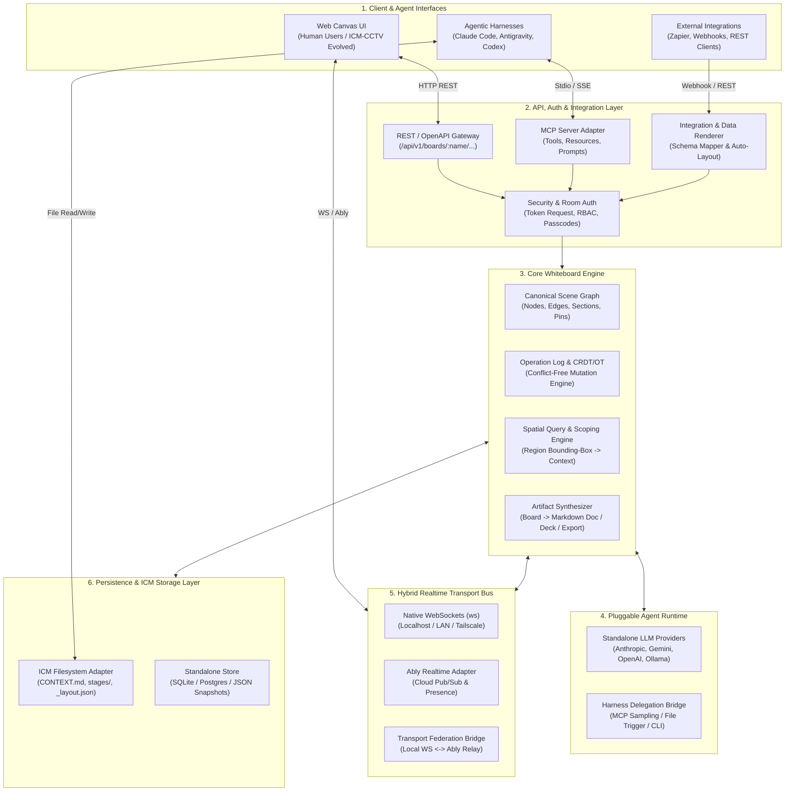
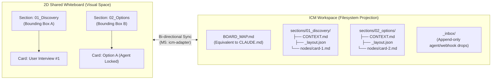
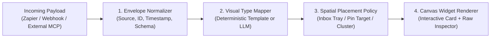
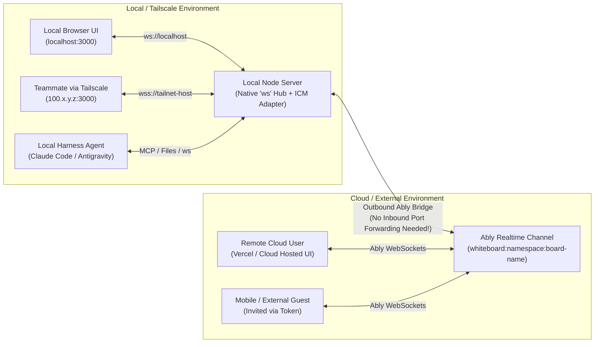
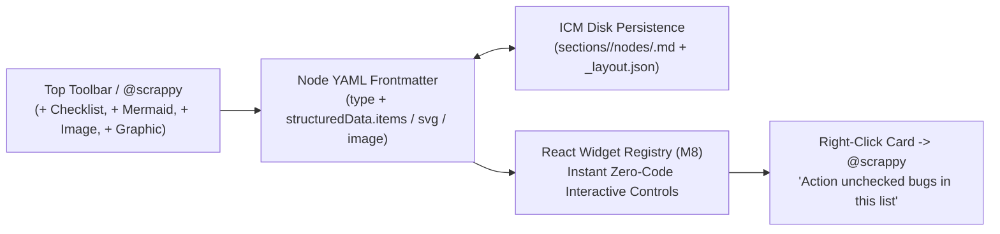
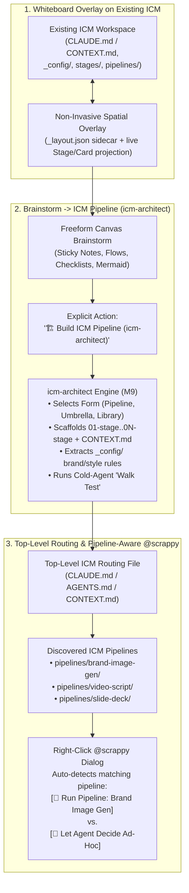

# Scrappy Whiteboard: Modular, API-First Collaborative & Agentic Canvas
**Architecture & System Design Document (v1.0 — Step 1 Review)**

---

## 1. Executive Summary & Vision

**Claude Whiteboards** demonstrates a compelling paradigm shift: moving AI collaboration out of linear chat threads and into a **shared spatial thinking canvas** where humans and agents brainstorm, cluster ideas, map flows, identify gaps, focus on spatial sub-regions, and synthesize visual structures into structured deliverables (documents, decks, plans).

However, Claude Whiteboards is a closed, vendor-locked SaaS feature with notable limitations (no connected app context at launch, tied to a single model provider, and unavailable in local CLI harnesses like Claude Code).

**Our Objective & Core Product Positioning:**
While we retain a **Standalone Application mode** with pluggable LLM provider APIs (Anthropic, Gemini, OpenAI, local Ollama), the **defining product moat and domain** that separates **Scrappy Whiteboard** from generic whiteboards (Miro, FigJam, Claude Whiteboards) is its **native, bi-directional symbiosis with the Interpretable Context Methodology (ICM)**.

Specifically, Scrappy Whiteboard is the **Visual Spatial Control Plane & Architect Studio for ICM**:
1. **Whiteboard Overlay on Any ICM Structure:** Mount the interactive whiteboard directly on top of any existing ICM workspace (`CLAUDE.md` / `CONTEXT.md`, numbered stages, `_config/`, `references/`) without polluting its clean filesystem contract.
2. **Brainstorm-to-ICM Pipeline Compiler (powered by `RinDig/icm-architect`):** Use the freeform canvas to brainstorm, cluster ideas, and map flows, then trigger an **explicit, first-class "Build ICM Pipeline" action** that uses the `icm-architect` methodology (and its **Walk Test**) to compile visual canvas flows into production-ready, agent-walkable ICM pipelines and routing tables.
3. **Top-Level ICM Routing & Pipeline-Aware `@scrappy` Execution:** Parse the top-level ICM routing markdown file (`CLAUDE.md` / `AGENTS.md` / `CONTEXT.md`) to discover specialized ICM pipelines (e.g., brand-compliant image generation, video scripting, slide deck creation). When the user invokes `@scrappy`, automatically detect matching ICM pipelines and let the user choose between **running a governed ICM pipeline** (enforcing brand/style `_config/`) or **letting the agent decide ad-hoc**.
4. **Works with any Agentic Harness & Standalone API:** Operates seamlessly with Claude Code, Google Antigravity (`agy`), OpenAI Codex CLI, or Cursor via files/CLI/MCP, *and* as a Standalone app with direct Model APIs.
5. **Supports Hybrid Federated Realtime Transport:** Scales from local WebSockets (`ws` on `localhost`), to Tailscale/LAN, to **Ably Realtime** cloud pub/sub.

---

## 2. Comparative Analysis of Reference Inputs

| Reference Source | Core Strengths to Adopt | Limitations / Challenges to Solve | Architectural Role in Our Design |
| :--- | :--- | :--- | :--- |
| **Claude Whiteboards** | • Spatial primitives (sticky notes, shapes, arrows, sections/frames)<br>• High-level AI actions (*Reorganize*, *Find Gaps*, *Region Focus*, *Board-to-Doc/Deck*)<br>• Voice dictation / brain-dump to structured flow<br>• Live cursor presence & "Follow teammate" | • Closed ecosystem; no connected app/webhook data<br>• Not available in CLI harnesses (Claude Code)<br>• Single-agent only (cannot mix Claude + Gemini + local scripts on one board) | **UX & Agent Capability Benchmark:** Defines our core spatial schema, AI spatial operations, region-scoped prompting, and export workflows. |
| **Interpretable Context Methodology (`RinDig/ICM`)** | • Filesystem-as-architecture (`CLAUDE.md`, numbered stages, `CONTEXT.md` contracts)<br>• Strict token discipline (2k–8k scoped context)<br>• Human-in-the-loop file editability | • **Inherently single-user & sequential**<br>• Race conditions if two agents/users edit markdown files concurrently<br>• Spatial 2D graphs don't naturally map to 1D numbered folders | **File-Backed State & Context Scoping Engine:** Provides our "Spatial Context Scoping" rules and bi-directional Markdown <-> Canvas projection. |
| **ICM-CCTV (`munronai/icm-cctv`)** | • *"ICM decides what the agent does; ICM-CCTV decides what you see"*<br>• Decoupled spatial metadata (`_layout.json`, pins) + `chokidar` file watching + local `ws` server<br>• Glass-box observability | • Designed primarily as a single-node developer starter/monitor rather than a multi-user, bi-directional collaborative whiteboard with auth and external API ingestion | **ICM Visual Adapter & Canvas Starter:** Serves as the foundation for the File-to-Canvas bridge and `_layout.json` spatial persistence model. |
| **ICM Architect (`RinDig/icm-architect`)** | • **Build & Restructure Modes:** Turns freeform process descriptions or messy folders into minimal, clean ICM workspaces (Pipelines, Record Libraries, Knowledge Bundles, Umbrella Projects, Context Maps)<br>• **Top-Level Routing (`CLAUDE.md` / `CONTEXT.md`)** + `_config/` brand/style separation<br>• **The "Walk Test":** Verifies a cold agent with zero memory can navigate and execute the pipeline from disk alone | • Text/CLI-only skill; lacks a visual spatial canvas for brainstorming stages before scaffolding, visualizing routing tables, or selecting pipelines interactively from a canvas prompt | **Canvas-to-Pipeline Compiler & Routing Engine (`M9`):** Powers our explicit **"Build ICM Pipeline"** action, **Walk Test verifier**, and **Top-Level Routing Pipeline Detector** for `@scrappy`. |
| **Ably Whiteboard (`ably-labs/whiteboard`)** | • Named channels (`whiteboard-<boardId>`)<br>• Stateless Token Auth (`/api/createTokenRequest`)<br>• Built-in Presence & low-latency Pub/Sub over WebSockets | • Pure ephemeral drawing strokes (`snake-canvas`) rather than semantic object graph (nodes/edges)<br>• Cloud-only unless paired with a local WebSocket fallback | **Realtime Transport & Security Pattern:** Inspires our pluggable Transport Layer, channel naming, presence protocol, and capability-based token security. |

---

## 3. Overarching Modular Architecture

To satisfy the requirement that **every part must be modular** and work both inside an agentic harness (file/MCP-driven) and as a standalone cloud/local app (API/WebSocket-driven), the system is decomposed into **7 decoupled modules** built around a central **Canonical Board State Engine**.



### Module Inventory & Boundaries

| Module ID | Module Name | Responsibility | Standalone Mode | ICM / Harness Mode |
| :--- | :--- | :--- | :--- | :--- |
| **`M1`** | **`@scrappy/core-schema`** | Canonical data model (nodes, edges, sections, data cards, pins), patch validation, spatial bounding-box math, and deterministic auto-layout algorithms (dagre/force/grid). | In-memory + SQLite/JSON | Projected to/from `_layout.json` + Markdown files |
| **`M2`** | **`@scrappy/api-gateway`** | API-first HTTP/REST server (OpenAPI 3.1), capability-based Token Auth (`/api/auth/token`), board lifecycle (`GET/POST/PATCH`), and webhook ingestion endpoints. | Full HTTP API server | Local lightweight daemon |
| **`M3`** | **`@scrappy/realtime-bus`** | Pluggable pub/sub & presence abstraction (`ITransportProvider`) supporting Native `ws`, Ably Realtime, and a **Federation Bridge** linking local Tailscale nodes to Ably channels. | Native `ws` or Ably Cloud | Local `ws` (like `icm-cctv`) + optional Ably sync |
| **`M4`** | **`@scrappy/mcp-server`** | Exposes the exact same API capabilities as MCP Tools and MCP Resources so Claude Code, Antigravity, or Codex can read/manipulate the board natively. | Remote MCP over SSE/HTTP | Local Stdio MCP server |
| **`M5`** | **`@scrappy/icm-adapter`** | Bi-directional synchronizer (`chokidar` + AST parser) mapping ICM folders, `CONTEXT.md`, and stage outputs to canvas Sections, Cards, and `_layout.json`. | Optional (Import/Export ICM zip) | Primary storage & multi-agent coordination layer |
| **`M6`** | **`@scrappy/agent-orchestrator`** | Handles AI spatial commands (*Organize*, *Find Gaps*, *Region Focus*, *To-Doc*, *Artistic SVG Graphic*). Uses direct LLM APIs in standalone mode, or delegates to the active Harness in harness mode. | Pluggable LLM SDKs (Claude, Gemini, OpenAI) | Harness-native (`/update-scrappy` reads scoped context & calls CLI/edits files) |
| **`M7`** | **`@scrappy/canvas-ui`** | Interactive 2D infinite canvas frontend (evolving `icm-cctv`), supporting pan/zoom, collapsible inspector, corner-resizable sections/cards, editable connector lines, and right-click `@scrappy` cursor prompts. | Hosted Web App | Local browser tab (`localhost:3000`) |
| **`M8`** | **`@scrappy/ui-library`** | Ready-made, persistent interactive widget & graphic library (`checklist`, `mermaid`, `image`, `svg_graphic`, `data_card`) backed by structured YAML frontmatter + `_layout.json` so interactive state survives restarts and agents don't reinvent UI code. | Bundled React Widget Registry | Persisted in ICM node frontmatter (`widgetData`) |
| **`M9`** | **`@scrappy/icm-architect-bridge`** | Integrates `RinDig/icm-architect` to: (1) overlay the canvas onto existing ICM workspaces, (2) explicitly compile whiteboard brainstorms into ICM Pipelines (with automated **Walk Test** validation), and (3) parse top-level routing markdown (`CLAUDE.md` / `CONTEXT.md`) to surface ready-made ICM pipelines inside `@scrappy` prompts. | Exports/Executes ICM Pipeline Bundles via Model API | Invokes `icm-architect` skill & executes ICM pipelines on disk |

---

## 4. Deep-Dive: Solving the Core Architectural Challenges

### 4.1 Challenge 1: Adapting ICM (Single-User Files) for Multi-Agent & Multi-User Shared Whiteboards

**The Problem:**
In standard ICM (`RinDig/Interpretable-Context-Methodology`), a single agent steps sequentially through numbered directories (`01_research/`, `02_synthesis/`, `03_plan/`), reading `CONTEXT.md` and writing markdown outputs. If two humans and three agents (e.g., Claude Code, Antigravity, and a standalone research agent) collaborate simultaneously on a whiteboard:
1. Two agents editing the same markdown file will overwrite each other.
2. Loading an entire multi-hundred-node whiteboard into an agent's prompt violates ICM's strict **Token Discipline (2k–8k tokens)**.
3. A 2D freeform whiteboard is spatial and non-linear, whereas ICM directories are hierarchical and sequential.

**The Architectural Solution: "Spatial ICM" & Scoped Ownership**



1. **Sections as ICM Stage Directories (`sections/<slug>/`):**
   - Every **Section (Frame/Group)** on the whiteboard maps to a directory in the ICM workspace, complete with its own `CONTEXT.md` contract and localized `_layout.json`.
   - Unassigned sticky notes live in `00_scratchpad/`.
2. **Spatial Context Scoping (Preserving Token Discipline):**
   - Just as standard ICM prevents an agent from reading irrelevant folders, **Spatial ICM** prevents an agent from reading the whole board.
   - `BOARD_MAP.md` (the root map, analogous to `CLAUDE.md`) contains *only* a lightweight index of Sections, their summaries, bounding boxes, and active locks (~500 tokens).
   - When a user drags a selection box on the canvas ("Focus on this area") or assigns an agent to a Section, the engine computes a **Spatial Context Slice**: only the nodes inside that bounding box + 1-hop connected edges are serialized into the agent's context window.
3. **Multi-Agent Concurrency via Node-Per-File + Optimistic Leases:**
   - Instead of one monolithic markdown file, each substantive card/cluster can be projected as an atomic file (`nodes/<node-id>.md` with YAML frontmatter for metadata/author/version) or managed via an append-only operation log (`_ops/agent-<id>.jsonl`).
   - **Soft Leases / Agent Presence:** Before an agent modifies a Section or Card, it acquires a lease (visible on the UI as a colored glowing border + agent avatar badge, just like Claude Sheets/Whiteboards cell outlines).
   - If an external harness agent writes directly to the filesystem without acquiring an API lock, the `icm-adapter` (`chokidar` watcher) diffs the file against the last known hash:
     - Clean fast-forward -> immediately broadcasts a `node.updated` event over WebSockets/Ably.
     - Conflicting edit -> creates a linked **"Conflict Fork Card"** pinned adjacent to the original card on the canvas so a human or resolver agent can merge them visually!

---

### 4.2 Challenge 2: Evolving `icm-cctv` as the ICM Visual Layer

**Your Question:** *"I created ICM-CCTV as a way of visualising data in ICM - is this a possible way to display whiteboard content when using ICM?"*

**Answer: Yes—`icm-cctv` is the ideal foundation, and its core philosophy (`_layout.json` + file watching + WebSocket streaming) maps directly to our `M5` + `M7` modules.**

To turn `icm-cctv` from a pipeline *monitor* into a full *collaborative whiteboard*, we extend its pattern in three specific ways:

| `icm-cctv` Current Concept | Evolution in Scrappy Whiteboard |
| :--- | :--- |
| **One-way observability** (Filesystem -> `chokidar` -> `ws` -> Browser Canvas) | **Bi-directional Manipulation:** Dragging a card, drawing an arrow, or typing a sticky note in the browser emits a `ws` mutation -> updates `_layout.json` and the underlying `.md` file atomically (with a write-debounce to prevent `chokidar` echo loops). |
| **`_layout.json`** (Positions, sizes, pins for stage outputs) | **Extended `_layout.json` Schema:** Retains `positions`, `sizes`, and `pins`, and adds `edges` (arrows with labels/routing), `sections` (visual grouping boxes), `zIndex`, and `locks` (active user/agent leases). Content stays in `.md` files; spatial geometry stays in `_layout.json`. |
| **Stage-centric pipeline view** (`stages/<stage>/output/`) | **Dual-Mode View ("Pipeline Mode" vs. "Freeform Board Mode"):** Users can toggle between viewing their ICM folder as a structured stage pipeline (`icm-cctv` classic) or as a freeform 2D brainstorming canvas where AI can reorganize clusters into numbered ICM stages once the structure settles! |

> [!TIP]
> **From Brainstorm to ICM Pipeline:** Because we combine Claude Whiteboard's brainstorming workflow with `icm-cctv`, a user can start with a messy voice brain-dump on the whiteboard, ask the agent to *"Organize this into a 4-stage workflow"*, and the system will automatically generate the numbered ICM directories (`01_...` to `04_...`), populate their `CONTEXT.md` files, and lay them out in `_layout.json`!

---

### 4.3 Challenge 3: API-First Architecture & Dual Agent Interaction Modes

We must support both **Standalone mode** (where a backend orchestrator calls an LLM API like Anthropic/Gemini/OpenAI) and **Harness mode** (where Claude Code, Antigravity, or Codex is *already* the reasoning loop and interacts with the board as an external environment).

Furthermore, agents interact with the whiteboard in two distinct ways:
1. **Semantic / Macro Actions (Intent-Driven):** *"Group these 15 sticky notes by theme"*, *"Find the missing steps in this launch flow"*, *"Turn Section 2 into a PRD markdown doc"*.
2. **Direct / Micro Actions (Peer Collaborator):** Moving a virtual cursor on the board, creating nodes, connecting arrows, and responding to `@agent` comments on a specific card—just like a human user.

#### Core REST API Surface (`/api/v1`)
Every action in the UI or MCP maps to this exact REST specification:

| Endpoint | Method | Description |
| :--- | :--- | :--- |
| `/api/v1/boards` | `POST`, `GET` | Create or list named whiteboards (`slug`, `title`, `visibility`, `storageMode`: `icm` \| `standalone`). |
| `/api/v1/boards/:name` | `GET`, `PATCH`, `DELETE` | Fetch board metadata, full scene graph, or filtered spatial slice (`?bbox=x1,y1,x2,y2` or `?section=id`). |
| `/api/v1/boards/:name/ops` | `POST` | Apply an atomic batch of graph operations (`create_node`, `update_node`, `move_node`, `delete_node`, `create_edge`, `group_into_section`). |
| `/api/v1/boards/:name/ingest` | `POST` | Push external structured/unstructured data (from webhooks, Zapier, other MCPs) to be rendered onto the board. |
| `/api/v1/boards/:name/agent/act` | `POST` | Trigger a standalone AI skill (`reorganize`, `find_gaps`, `brain_dump_to_flow`, `region_prompt`, `synthesize_artifact`) using the configured LLM API. |
| `/api/v1/boards/:name/export` | `POST` | Convert the board (or a section) into Markdown Doc, Slide Deck outline, ICM Pipeline directory, Mermaid diagram, or PNG/SVG. |
| `/api/v1/auth/token` | `POST` | Exchange room passcode / API key / OAuth token for a signed capability token (works for both local WebSockets and Ably Token Auth). |

#### MCP Server Surface (`@scrappy/mcp-server`)
Built as a thin, zero-business-logic adapter directly on top of the Core API Layer:
- **MCP Resources:**
  - `whiteboard://{boardName}/map` -> High-level summary of sections, node counts, and active collaborators (fits in <1k tokens).
  - `whiteboard://{boardName}/section/{sectionId}` -> Scoped markdown + graph representation of a single section.
  - `whiteboard://{boardName}/selection/{userId}` -> Whatever region the human user currently has highlighted on their screen!
- **MCP Tools:**
  - `wb_get_context(board, sectionId?, bbox?, includeConnected?)`
  - `wb_mutate_batch(board, operations[], autoLayout?)` — Allows an agent to emit 10 sticky notes and 8 arrows *without* having to calculate pixel coordinates manually if `autoLayout: "dagre" | "grid" | "cluster"` is specified!
  - `wb_presence_announce(board, agentName, status, targetNodeId?)` — Lets Claude Code or Antigravity show a live virtual cursor and *"Thinking on Card X..."* badge on the human's canvas.
  - `wb_synthesize_doc(board, sectionId?, format: "doc" | "deck" | "icm_stages")`

> [!IMPORTANT]
> **Why `autoLayout` in `wb_mutate_batch` is Critical for Agent DX:**
> LLMs are great at semantic topology (Node A leads to Node B and Node C inside Section 1) but mediocre at calculating exact pixel collision avoidance on a 2D canvas. By letting agents emit *semantic topology* or *relative placement* (`place: "right-of:node-1"` or `layout: "flowchart-lr"`) while our deterministic layout engine (`M1`) computes exact `(x, y, width, height)` coordinates, agent tool calls become 5x faster, cheaper in tokens, and visually clean every time.

---

### 4.4 Challenge 4: Rendering Data from External Integrations (MCP / Webhooks / Zapier)

**Your Question:** *"The integration layer should also allow for MCP on top of the API layer and also allow integrations/hooks into other API/MCP/Zapier - this presents a challenge: how should data from integrations be rendered on the whiteboard?"*

When an external system (a Zapier webhook, a GitHub issue event, a CRM record via MCP, or a CSV/metric payload like *Claude Data*) pushes arbitrary JSON into `/api/v1/boards/:name/ingest`, dumping raw JSON text onto a sticky note ruins the whiteboard UX.

**The Solution: A 4-Stage Integration Rendering Pipeline & "Live Data Cards"**



1. **Stage 1: Canonical Integration Envelope (`IntegrationEvent`):**
   Every webhook or MCP hook normalizes data into:
   - `source`: e.g., `"github"`, `"zapier"`, `"sanity-mcp"`, `"stripe"`
   - `externalId`: Unique key for idempotency (if the same GitHub PR updates from `open` to `merged`, the existing card on the whiteboard updates in-place with a highlight pulse rather than spawning duplicate cards!).
   - `payload`: The structured JSON data.
   - `displayHint` (optional): `"card" | "table" | "metric" | "graph" | "sticky_batch"`.

2. **Stage 2: Polymorphic Visual Primitives (How Data Renders on Canvas):**
   Instead of only plain text sticky notes, our canvas supports **5 semantic node renderers**:
   - **Sticky Note / Shape:** Simple text, color, tags.
   - **Structured Data Card (Key-Value / Entity Card):** Renders a clean header with source icon, status badge, 3–5 key attributes, and a clickable URL. (Ideal for Jira/Linear tickets, GitHub PRs, CRM leads from Zapier).
   - **Mini-Table / Sheet Node:** Renders tabular arrays (inspired by *Claude Sheets* inside the board) for CSV rows or SQL/MCP query results.
   - **Metric / Sparkline Tile:** Renders KPI numbers + trend indicators (inspired by *Claude Data*).
   - **Sub-Graph / Decomposed Cluster:** When an integration payload contains relationships (e.g., an incident webhook with 4 affected services), the mapper decomposes it into multiple connected nodes inside a bounded Section.

3. **Stage 3: Spatial Placement Policies (Preventing Canvas Chaos):**
   Where does incoming webhook data land so it doesn't cover up what humans are currently drawing?
   - **Policy A — The "Integration Inbox" Dock (Default for unmapped webhooks):** Incoming events land in a dedicated, collapsible **Inbox Lane** on the edge of the board (with an unread badge), allowing humans or agents to drag or auto-route them onto the main canvas.
   - **Policy B — Target Section / Pin Routing:** Webhooks can pass `?section=01_bugs` or attach to an `icm-cctv`-style **Pin** (`?pin=webhook-sink-1`), auto-stacking neatly in a grid inside that Section.
   - **Policy C — Semantic Auto-Clustering:** An agent hook evaluates the incoming item and places it next to semantically related cards on the board.

4. **Stage 4: Glass-Box Inspection (Progressive Disclosure):**
   Every rendered integration card displays a clean summary at standard zoom, expands into full fields when zoomed in (**Semantic Zoom**), and has a `{ } Inspect Payload` toggle that opens the raw JSON/Markdown source (staying true to `icm-cctv`'s glass-box ethos).

---

### 4.5 Challenge 5: Hybrid Realtime Networking (Localhost, Tailscale, LAN, and Ably Cloud)

**Your Requirement:** *"In terms of connecting users, we are looking at websockets but this has to work as something running locally and then potentially exposed using tailscale or similar in addition to hosted for an internal network and also for cloud hosting. In theory, these should be able to work together for a single whiteboard. As with the ably demo, the whiteboard should have a name and optionally some security to lock it down to a particular user group."*

To make local `ws`, Tailscale/LAN, and Cloud (Ably) work **independently OR together on the same named whiteboard**, we design a unified **Realtime Transport & Federation Layer (`M3`)**.



#### How the 4 Deployment Topologies Work Seamlessly:
1. **Topology 1: Pure Local (`ws` Native):**
   - Runs 100% offline/local on `ws://127.0.0.1:3000`. Zero cloud accounts required. Great for solo developer + local agents (`icm-cctv` mode).
2. **Topology 2: Local + Tailscale / LAN Exposure (`ws`/`wss` Native):**
   - Server binds to `0.0.0.0` or Tailscale interface (`tailscale serve` / MagicDNS). Teammates on the tailnet or corporate LAN connect directly to the native WebSocket server (`ws://my-machine.tailnet.ts.net:3000/ws/boards/launch-plan`).
3. **Topology 3: Pure Cloud Hosted (Ably Realtime):**
   - Frontend hosted on static/edge hosting (Vercel, Netlify, Cloudflare, Firebase) using the Ably SDK (`whiteboard:<boardName>`), authenticating via `/api/v1/auth/token` (just like `ably-labs/whiteboard`).
4. **Topology 4: Hybrid Federated Mode (Local/Tailscale + Ably Cloud Together on One Board):**
   - **How it works:** The local server runs the `AblyFederationBridge`. It connects *outbound* as an Ably client to channel `whiteboard:<boardName>`.
   - Any mutation or cursor event on the local/Tailscale `ws` hub is stamped with an `originServerId` and `opId` (for deduplication) and published to Ably.
   - Any event published by a remote cloud user on Ably is received by the local server's bridge, applied to the local state (and ICM files!), and broadcast to all local/Tailscale `ws` clients.
   - **Result:** A developer running Claude Code + ICM files on their MacBook can collaborate live on the exact same board with a colleague on Tailscale *and* an external client accessing the cloud-hosted URL via Ably—without opening a single public firewall port!

#### Board Naming & Security Model
- **Board Addressing:** Every board has a human-friendly URL slug (`/b/:boardName`, e.g., `/b/q4-product-launch`) mapped to channel `whiteboard:default:q4-product-launch`.
- **3-Tier Security per Board:**
  1. **Public / Open Link:** Anyone with the board name can join (great for quick local/LAN jams).
  2. **Passcode / Shared Secret Protected:** Users enter a room passcode (or agents pass `X-Board-Secret`), which `/api/v1/auth/token` verifies before issuing a signed JWT / Ably `TokenRequest`.
  3. **User Group / RBAC Lockdown:** Locked to an allowed list of user emails, GitHub/Google org domains, or Tailscale identity headers (`Tailscale-User-Login`).
- **Capability Scopes:** Tokens encode granular capabilities matching Ably's capability model:
  - `read`: View board & follow cursors
  - `write`: Create/move/edit nodes
  - `agent`: Acquire agent leases & write to AI suggestion layers
  - `admin`: Change security settings, lock sections, approve external merges

---

### 4.6 Challenge 6: More Artistic / Graphic Interpretations Beyond Boxes-and-Arrows

**The Problem:**
In the Claude Whiteboards video (`youtu.be/YewAJPawE7I`), asking the AI to illustrate a concept or visualize an architecture doesn't just produce uniform rectangular sticky notes—it can produce **expressive, artistic graphics, custom visual metaphors, mind-maps, radial diagrams, and rich vector illustrations**.

**The Architectural Solution: Dual Graphic Primitives (`svg_graphic` & `mermaid` Nodes)**
1. **Artistic SVG Graphic Card (`type: 'svg_graphic'`):**
   - Allows `@scrappy` (via `agy` or Standalone Model API) to emit bespoke, multi-layered inline SVG illustrations (e.g., architectural diagrams, product funnels, visual metaphors, custom icons, radial mind-maps, or hand-drawn style vector sketches) inside a resizable, frameless or framed canvas node.
   - Because the raw SVG code is stored in the node's ICM file (`content.svgContent` / markdown code block) and its bounding box is stored in `_layout.json`, the graphic scales crisply at any zoom level and persists across restarts.
2. **Live Mermaid Diagram Shape (`type: 'mermaid'`):**
   - Renders Mermaid markdown (`flowchart`, `sequenceDiagram`, `stateDiagram-v2`, `classDiagram`, `erDiagram`, `mindmap`) **in-place as a crisp SVG graphic** on the whiteboard.
   - Double-clicking (or clicking `✏️ Edit Mermaid`) switches the shape into a live Markdown code editor; clicking `✓ Render Diagram` compiles and renders the visual diagram back onto the canvas.

---

### 4.7 Challenge 7: Ready-Made Interactive Control Library & State Persistence (`@scrappy/ui-library`)

**The Problem:**
In early testing, asking `agy` to create an interactive checklist of bugs with add/remove capability had two major flaws:
1. **Slow Agent Generation:** It took `agy` a long time to synthesize custom interactive UI logic from scratch.
2. **Loss of Interactivity on Restart:** When the board restarted, `ICMAdapter` only reloaded `title` and `body` markdown text, losing the interactive checklist controls! Furthermore, the natural human-first workflow is for the **user** to drop an interactive Bug Checklist onto the canvas, add/edit bugs, and then ask `@scrappy` to action the unchecked items.

**The Architectural Solution: Declarative Widget Registry (`M8: @scrappy/ui-library`)**



1. **First-Class Interactive Widget Types in Core Schema & ICM Adapter:**
   Instead of asking `agy` to write ad-hoc React/HTML code, `@scrappy/ui-library` provides pre-built, stateful React canvas components whose state serializes deterministically into the node's YAML frontmatter (`structuredData`) in `sections/<slug>/nodes/<id>.md`:
   - **`checklist` (Interactive Checklist / Bug Tracker Card):**
     - Ready-made UI control with interactive checkboxes (`✓`), inline **Add Item (`+ Add bug/task...`)**, **Remove Item (`✕`)**, progress bar (`2/5 done`), and a 1-click **`⚡ Ask @scrappy to Action Open Items`** trigger.
     - Persists `structuredData.items: Array<{ id, text, checked, priority? }>` in the `.md` frontmatter AND syncs `- [x] / - [ ]` markdown lines in the `.md` body so both the interactive UI and raw Markdown file stay 100% in sync across restarts!
   - **`mermaid` (In-Place Mermaid Diagram Shape):**
     - Renders Mermaid syntax into a live SVG diagram on the board; toggles to raw Mermaid markdown when editing.
   - **`image` (Clipboard Paste & Image Upload Card):**
     - Supports pressing **`Cmd+V` / `Ctrl+V`** anywhere on the whiteboard to paste a screenshot/image from the clipboard (or picking a file / pasting an image URL via **`+ Image`**), persisted as a data URI or local asset in `boards/<name>/_assets/` so images survive restarts.
   - **`svg_graphic` (Artistic Vector Illustration Card):**
     - Renders expressive SVG artwork, visual metaphors, and custom diagrams generated by `@scrappy`.
2. **Growing the Library Over Time:**
   - Every widget in `src/client/widgets/` follows a uniform `WidgetProps<TData>` interface. Whenever users request a new interactive control pattern (e.g., a Priority Matrix, Voting Counter, or Kanban Table), it is added once to the library and immediately available in 0ms to both humans (from the toolbar) and `agy` (by setting `type` + `structuredData`).

---

### 4.8 Challenge 8: Frictionless Canvas <-> `agy` Ergonomics, Permission Settings & Spatial Scope Fidelity

**The Problem:**
1. Switching from the canvas to `agy` felt slow when `agy` had to ask for multiple shell/file permissions or generate boilerplate.
2. `/update-scrappy` must strictly respect the active **Focus Region / Scope Section** both for *what context it reads* and *where it positions newly created cards/diagrams*.
3. Users need full control over **Connector Lines** (switching between solid persistent grey lines, dashed lines, or animated blue flow lines, and editing edge labels) and screen real estate (**Collapsible Right-Hand Panel**).

**The Architectural Solution:**
1. **Zero-Prompt Permission Configuration for `agy` (`.gemini/settings.json` & Prefix-Matchable Commands):**
   - Antigravity's permission system generalizes approvals by **prefix-matching simple binary + subcommand shapes** (whereas shell chains with `&&`, `;`, or `$(...)` force re-prompting every time).
   - We configure `.gemini/settings.json` in the workspace with pre-allowed commands (`npm run wb`) and add a single composite CLI command:
     ```bash
     npm run wb -- apply-json --board launch-plan --file <ops.json>
     ```
     and flag options on `npm run wb -- update-scrappy` so `agy` executes **one clean, prefix-matchable command** without triggering permission popups.
2. **Strict Focus Region / Scope Positioning in `/update-scrappy`:**
   - When a Focus Region bounding box (`activeSelection.boundingBox`) or Scope Section (`selectedSectionId`) is active, `/update-scrappy` (and `ACTIVE_PROMPT.md`) locks the output coordinate origin to the **interior of that Focus Region or Scope Section** (and automatically expands the Scope Section's bounds if new cards need more room).
3. **Interactive Edge Inspector & Collapsible Right Panel:**
   - Clicking any connector line (or its label) opens a floating **Connector Style & Label Editor** allowing instant switching between **`Solid (Persistent Grey)`**, **`Dashed`**, and **`Animated (Blue Dotted)`**, plus inline label editing and deletion.
   - The right-hand prompt/inspector panel features an always-accessible collapse/expand tab handle so users can collapse it for 100% full-screen whiteboard space.

---

### 4.9 Challenge 9: Product Positioning — The ICM-Native Whiteboard & `RinDig/icm-architect` Integration (`M9`)

**Strategic Product Insight:**
While Scrappy Whiteboard retains a **Standalone Mode** (direct Model APIs + WebSockets/Ably), its **core product differentiation** over Miro, FigJam, or Claude Whiteboards is its **native position as the Visual Control Plane for the Interpretable Context Methodology (ICM)** and its direct integration with **`RinDig/icm-architect`**.

Most whiteboards suffer from the *"Post-Brainstorm Cliff"*: teams brainstorm sticky notes and diagrams, and then someone has to manually translate that canvas into prompts, folders, or agent workflows. Conversely, ICM workspaces (`RinDig/Interpretable-Context-Methodology` & `RinDig/icm-architect`) turn folders and Markdown files into deterministic, low-token agent architectures—but lack an interactive spatial surface for visual ideation, pipeline authoring, and visual routing.

We bridge this gap through **three explicit product capabilities** in Module **`M9` (`@scrappy/icm-architect-bridge`)**:



#### Capability 1: Applying the Whiteboard on Top of Any Existing ICM Structure ("ICM Overlay Mode")
- **How It Works:** A user can mount Scrappy Whiteboard onto *any* existing ICM directory (whether created by hand, generated by `icm-architect`, or monitored by `icm-cctv`).
- **Structure Discovery & Visual Projection:**
  1. **Root Routing Header:** Parses the workspace's top-level entry file (`CLAUDE.md`, `AGENTS.md`, or `CONTEXT.md`) and renders a pinned **Workspace Router Map** header/dock showing global `_config/` assets (e.g., `brand-voice.md`, `style-guide.md`), shared `references/`, and registered pipelines.
  2. **Stage-to-Section Mapping:** Every numbered ICM stage folder (`01-scope/`, `02-research/`, `03-draft/`, `04-review/` or `stages/01-.../`) maps to a resizable, color-coded **Scope Section** on the canvas, with its `CONTEXT.md` contract (Role, Inputs, Process, Outputs, Gate Check) inspectable and editable in-place.
  3. **Zero-Pollution Sidecar Geometry:** All 2D positions, card dimensions, colors, and visual connector styles are stored in `_layout.json` so the underlying ICM folder remains 100% pure Markdown and passes `icm-architect`'s cold-agent **Walk Test** at all times.

#### Capability 2: Brainstorming on the Canvas -> Explicit ICM Pipeline Compilation via `icm-architect`
- **The UX Problem Solved:** Converting a messy brainstorm into a structured ICM pipeline should not be an invisible side-effect—it must be an **explicit, obvious, first-class user action** on the whiteboard.
- **Explicit UI Entry Points:**
  1. **Top Toolbar & Scope Section Header Button:** A prominent **`🏗️ Build ICM Pipeline`** button in the main toolbar and on every Scope Section header.
  2. **Right-Click `@scrappy` Action:** Right-clicking a cluster of cards or a Scope Section and selecting **`🏗️ Compile into ICM Pipeline (icm-architect)`**.
- **How `icm-architect` (`M9`) Compiles the Canvas into an ICM Pipeline:**
  When triggered on a selected region, Scope Section, or entire board, the `icm-architect` bridge executes a **4-step compilation workflow**:
  1. **Form Classification (`icm-architect` Build Mode):** Inspects the topology of the canvas nodes and edges (linear chain, branching DAG, reference collection, or multi-workflow hub) and recommends the smallest valid ICM structural form:
     - **Pipeline (`01-stage/` -> `02-stage/` -> `03-stage/`):** For sequential/DAG flows (e.g., content generation, image creation, bug triage).
     - **Umbrella Project (`CLAUDE.md` router + `pipelines/*`):** When multiple Scope Sections represent distinct recurring workflows.
     - **Record Library / Knowledge Bundle:** When cards represent reference entities or research clusters.
  2. **Stage & Contract Synthesis:**
     - Groups connected canvas cards into numbered stage directories (`01-brief/`, `02-style-lock/`, `03-generate/`, `04-qa/`).
     - Synthesizes each stage's `CONTEXT.md` with explicit **Role, Required Inputs (pointing to prior stage `output/` and `_config/`), Step-by-Step Instructions, Expected Output Format, and Stop/Gate Conditions**.
     - Extracts pinned reference/style cards on the board into `_config/` (e.g., `_config/brand-guidelines.md`, `_config/tone.md`).
  3. **Top-Level Routing Registration:**
     - Creates or updates the workspace's top-level routing markdown file (`CLAUDE.md` / `AGENTS.md` / `CONTEXT.md`) with a **Pipeline Routing Entry** (Trigger keywords, Purpose, Entry Stage path, Required `_config/`, and Final Output location).
  4. **Automated "Walk Test" Verification Badge:**
     - Runs `icm-architect`'s **Walk Test** (simulating a cold agent with zero prior memory starting at the root routing file and tracing every file reference and stage handoff).
     - Displays a live **`✅ ICM Walk Test Passed (4 Stages, 0 Broken Refs)`** badge directly on the whiteboard pipeline container!

#### Capability 3: Top-Level Routing File Discovery & Pipeline-Aware `@scrappy` Execution
- **The Problem:** In a mature ICM workspace, the top-level routing markdown file (`CLAUDE.md`, `AGENTS.md`, or `CONTEXT.md`) routes specific intents to dedicated, battle-tested ICM pipelines—for example:
  - **Image Generation Pipeline (`pipelines/brand-image-gen/`):** Reads `_config/brand-palette.md` and `_config/illustration-style.md` before crafting the image prompt and generating the asset.
  - **Video Script / Storyboard Pipeline (`pipelines/video-content/`):** Follows hook -> retention beats -> visual storyboard stages.
  - **Slide Deck Pipeline (`pipelines/slide-deck/`):** Structures narrative arc -> slide-by-slide markdown -> Mermaid/SVG visuals.
  When a user right-clicks the canvas and asks `@scrappy generate an architecture hero image` or `@scrappy create a 5-slide launch deck`, `@scrappy` shouldn't blindly improvise if a governed ICM pipeline already exists in the routing file!
- **The Architectural Solution: The `@scrappy` Pipeline Router & Mode Selector**
  1. **Continuous Routing File Indexing (`M5` + `M9`):**
     - `ICMAdapter` parses the top-level routing file (`CLAUDE.md` / `AGENTS.md` / `CONTEXT.md` / `BOARD_MAP.md`) and any `pipelines/*/CONTEXT.md` files into an in-memory `ICMPipelineRegistry`:
       ```typescript
       export interface RegisteredICMPipeline {
         id: string;                // e.g., "brand-image-gen"
         title: string;             // e.g., "Brand-Aligned Image Generator"
         routingPath: string;       // e.g., "pipelines/brand-image-gen/CONTEXT.md"
         triggerIntents: string[];  // e.g., ["image", "illustration", "graphic", "hero", "visual"]
         configRefs: string[];      // e.g., ["_config/brand-style.md", "_config/colors.md"]
         stages: string[];          // e.g., ["01-prompt-spec", "02-brand-check", "03-render"]
         outputWidgetType: 'image' | 'svg_graphic' | 'mermaid' | 'checklist' | 'sticky';
         walkTestPassed: boolean;
       }
       ```
  2. **Real-Time Pipeline Detection in the Right-Click `@scrappy` Popup:**
     - As the user types (or voice-dictates) their `@scrappy` prompt in the right-click cursor dialog (e.g., `@scrappy create an image for our Q4 launch`), the UI matches the prompt against `ICMPipelineRegistry` and displays an explicit **Execution Route Selector** directly inside the popup:
       - **Option A — `🎯 Use ICM Pipeline: Brand-Aligned Image Generator` (Highlighted when matched):**
         Shows a pill listing the pipeline stages (`01-prompt-spec -> 02-brand-check -> 03-render`) and attached configs (`_config/brand-style.md`). Selecting this executes the structured ICM pipeline step-by-step and drops the resulting artifact into the target Focus Region / Scope Section on the whiteboard.
       - **Option B — `🧠 Freeform Agent Decision (Ad-Hoc)`:**
         Lets `@scrappy` (`agy` or Standalone Model API) fulfill the request directly using its own judgment without running a multi-stage pipeline.
       - **Option C — `🏗️ Scaffold New ICM Pipeline with icm-architect`:**
         Turns the current prompt + scoped canvas context into a brand-new reusable ICM pipeline and registers it in the top-level routing file for future `@scrappy` calls!
  3. **Seamless Recording in `ACTIVE_PROMPT.md` (for `agy`) & Standalone API:**
     - When queued in ICM mode, `ACTIVE_PROMPT.md` explicitly records `selectedPipelineId`, the top-level routing path (`pipelines/brand-image-gen/CONTEXT.md`), and the required `_config/` files so `/update-scrappy` in `agy` follows the exact ICM pipeline contract (or runs ad-hoc if Option B was chosen).

---

## 5. Canonical Data & Protocol Specification

To ensure every module (`core`, `icm-adapter`, `mcp-server`, `canvas-ui`, `realtime-bus`) stays cleanly decoupled, they communicate strictly through two schemas: **The Scene Graph Schema** and **The Realtime Envelope Protocol**.

### 5.1 Canonical Board Scene Graph (`BoardDocument`)
```typescript
export interface BoardDocument {
  id: string;
  name: string; // e.g., "q4-launch-plan"
  title: string;
  version: number; // Monotonic revision counter
  security: {
    mode: 'public' | 'passcode' | 'group';
    allowedGroups?: string[];
  };
  sections: Record<string, SectionNode>; // Maps to ICM numbered folders!
  nodes: Record<string, CanvasNode>;
  edges: Record<string, CanvasEdge>;
  pins: Record<string, PinAnchor>; // Inherited & extended from icm-cctv
}

export interface SectionNode {
  id: string;
  slug: string; // e.g., "01_research"
  title: string;
  bounds: { x: number; y: number; width: number; height: number };
  color?: string;
  icmContextPath?: string; // e.g., "sections/01_research/CONTEXT.md"
}

export interface CanvasNode {
  id: string;
  type: 'sticky' | 'shape' | 'text' | 'data_card' | 'table' | 'metric' | 'media';
  sectionId?: string; // Parent section if inside one
  position: { x: number; y: number };
  size: { width: number; height: number };
  content: {
    title?: string;
    body: string; // Markdown text
    structuredData?: Record<string, unknown>; // For integrations (Zapier/MCP)
    sourceMeta?: { provider: string; externalId?: string; url?: string };
  };
  style?: { color?: string; shape?: 'rect' | 'pill' | 'diamond'; border?: string };
  lock?: { holderId: string; holderType: 'human' | 'agent'; expiresAt: number };
  updatedBy: string;
  updatedAt: string;
}

export interface CanvasEdge {
  id: string;
  fromNodeId: string;
  toNodeId: string;
  label?: string;
  style?: 'solid' | 'dashed' | 'animated';
  directed: boolean;
}
```

### 5.2 Realtime Pub/Sub & Presence Protocol (Native WS & Ably)
All messages over native WebSockets and Ably channels use a deterministic JSON envelope:
- **Channel:** `whiteboard:{boardName}`
- **Event Types:**
  - `op.batch`: `{ opId, originId, actorId, actorType: 'human'|'agent', baseVersion, operations: GraphOp[] }`
  - `presence.update`: `{ actorId, name, role: 'human'|'agent', color, cursor: { x, y }, viewport?: { x, y, zoom }, activeNodeId?, statusText? }` (Enables **"Follow Teammate / Follow Agent"** camera syncing!)
  - `agent.suggestion`: `{ suggestionId, agentId, prompt, proposedOps: GraphOp[], status: 'pending'|'accepted'|'rejected' }` (Allows AI to propose "Find the gaps" cards with a ghost/dashed outline that humans can 1-click accept!)

---

## 6. Phased Implementation Plan (Step 2 MVP -> Step 3 Full Modular Build)

Based on architectural review, **Step 2 (MVP)** is split into two focused stages so we can validate the core **Single-User + Antigravity CLI (`agy`)** loop first before expanding to multi-user/federated transport.

### Phase 1A: Single-User + Antigravity CLI Whiteboard MVP (Current Build)
**Goal:** Deliver a rich, working React + SVG + HTML5 Canvas whiteboard backed by ICM Option A files (`sections/<slug>/nodes/<id>.md` + `_layout.json`), REST API, and local WebSockets (`ws`), seamlessly integrated with **Antigravity CLI (`agy`)** as the whiteboard agent.

**Phase 1A Scope:**
1. **Core Engine, Auto-Layout & REST API (`M1` + `M2`):**
   - Named whiteboards (`boards/<board-name>/`) with REST API (`/api/v1/boards/:name`, `/ops`, `/prompts`, `/ingest`, `/export`).
   - Deterministic auto-layout engine (`grid`, `flowchart-lr`, `flowchart-tb`, `sections`) so Antigravity CLI can emit semantic nodes/edges without manual pixel math.
   - Spatial Context Scoping (`?bbox=` and `?selected=true`) enforcing ICM's 2k–8k token discipline.
2. **ICM Option A Bi-Directional File Adapter (`M5`):**
   - **Node-per-file granularity:** Each card is stored as `boards/<name>/sections/<slug>/nodes/<node-id>.md` with YAML frontmatter + Markdown body, paired with section `CONTEXT.md`, root `BOARD_MAP.md`, and `_layout.json`.
   - Live `chokidar` file watcher: when Antigravity CLI creates, edits, or moves markdown files or updates `_layout.json`, the browser canvas updates in `<50ms` over WebSockets.
3. **Antigravity CLI (`agy`) Bridge (`M4` + Workspace Customizations):**
   - **Canvas-to-CLI Prompt Queue (`_prompts/ACTIVE_PROMPT.md`):** Selecting a region on the canvas (or dictating/typing a prompt in the UI) writes a scoped ICM prompt contract to `_prompts/ACTIVE_PROMPT.md` with only the relevant spatial context slice.
   - **CLI Tool (`npm run wb`) & MCP Server (`src/mcp/server.ts`):** Allows Antigravity CLI to inspect scoped board context, broadcast live agent presence/cursor status (`"Antigravity is reorganizing..."`), apply batch operations, and resolve prompts.
   - **Workspace Rules & Skill (`GEMINI.md`, `AGENTS.md`, `.agents/skills/scrappy-whiteboard/SKILL.md`):** Zero-config discovery for `agy`.
4. **Rich React + SVG + HTML5 Canvas Frontend (`M7`):**
   - HTML5 Canvas infinite grid/dot background + SVG curved/directed connector layer + React interactive node layer.
   - Sticky notes, shapes (`rect`, `pill`, `diamond`), sections/frames, directed arrows, and structured integration Data Cards.
   - **Region Focus Tool** (drag across a region to scope Antigravity's context), **Voice Dictation** (Web Speech API), **Ghost AI Suggestions** (accept/reject gap cards), **Live ICM Glass-Box File Inspector**, and **Board-to-Doc Export**.

### Phase 1B: Interactive UI Library, Artistic Graphics & `agy` Ergonomics (Current Iteration)
Based on initial MVP testing with `agy`:
1. **Ready-Made Interactive Widget Library (`M8`):**
   - **Interactive Checklist Card (`checklist`):** Add/remove/check items (e.g., bug lists) directly on the canvas with full persistence across restarts (`structuredData.items` + Markdown task list sync), plus right-click `@scrappy` to action open bugs.
   - **In-Place Mermaid Diagram Shape (`mermaid`):** Renders Mermaid markdown into a live SVG diagram on the board when editing is complete, and switches to Mermaid markdown editor when editing is selected.
   - **Image Paste & Upload Card (`image`):** Paste images directly onto the canvas (`Cmd+V` / `Ctrl+V`) or add via toolbar/URL with full persistence.
   - **Artistic SVG Graphic Card (`svg_graphic`):** Enables `@scrappy` to generate expressive vector illustrations, diagrams, and visual metaphors beyond simple boxes-and-arrows.
2. **Canvas UX & Spatial Fidelity Upgrades:**
   - **Collapsible Right-Hand Drawer** with floating edge toggle for maximum canvas real estate.
   - **Interactive Connector Inspector:** Click any connector line to switch between `Solid (Persistent Grey)`, `Dashed`, and `Animated (Blue Dotted)` styles and edit its label.
   - **Focus-Region Scoped `/update-scrappy`:** Strictly scopes both context and output card placement to the active Focus Region or Scope Section.
3. **`agy` Permission & Speed Optimization:**
   - Workspace `.gemini/settings.json` allowlist + prefix-matchable `npm run wb` commands so `agy` runs without repeated permission prompts.

### Phase 1C: ICM Architect Integration, Pipeline Compiler & Routing-Aware `@scrappy` (`M9`)
1. **Top-Level ICM Routing File Parser & Registry (`CLAUDE.md` / `AGENTS.md` / `CONTEXT.md`):**
   - Automatically index top-level ICM routing tables, `_config/` brand/style guides, and registered sub-pipelines (`pipelines/*/`).
   - Provide starter ICM pipelines out-of-the-box in the workspace (e.g., **Brand Image & Graphic Pipeline**, **Slide/Narrative Deck Pipeline**, **Video Script & Storyboard Pipeline**, **Bug Triage & Fix Pipeline**) referenced from the root routing markdown file.
2. **Pipeline-Aware Right-Click `@scrappy` Dialog:**
   - As the user types `@scrappy ...`, detect matching ICM pipelines from the top-level routing file and offer an explicit choice in the popup:
     - **`🎯 Run Matched ICM Pipeline`** (executes governed stages + `_config/` brand/style rules)
     - **`🧠 Let Agent Decide (Ad-Hoc)`** (standard freeform `@scrappy` execution)
3. **Explicit "Build ICM Pipeline (`icm-architect`)" Action & Walk Test:**
   - Add a prominent **`🏗️ Build ICM Pipeline`** action in the toolbar and Scope Section headers that invokes the `icm-architect` methodology (`RinDig/icm-architect`) to compile freeform canvas brainstorms into numbered stage folders (`01-stage/`, `02-stage/`), generate `CONTEXT.md` contracts, register the new pipeline in the top-level routing markdown file, and run the **Cold-Agent Walk Test**.
4. **Mount Whiteboard on Existing ICM Workspaces:**
   - Support opening any existing ICM directory on disk as an interactive whiteboard overlay via `_layout.json`.

### Phase 1D: Multi-User, Auth & Ably Realtime Expansion
Once Phase 1C is validated:
1. Enable multi-user presence ("Follow teammate"), Passcode/Token security (`/api/v1/auth/token`), Tailscale/LAN sharing, and the `AblyFederationBridge` (`M3`).

### Phase 2: Step 3 Modular Build-Out & Automated Test Suite
1. **Contract & Unit Tests (Vitest):** Scene Graph mutations, Spatial bounding-box scoping, and ICM Option A file <-> `_layout.json` round-trip tests.
2. **Standalone Multi-Provider Agent Runtime (`M6`):** Direct LLM API adapters (Claude, Gemini, OpenAI) for standalone server mode.
3. **Rich Integration Renderers:** Webhook/Zapier Inbox dock, live metric/table nodes, and 1-click export to ICM multi-stage pipeline folders.

---

## 7. Finalized Design Decisions (Locked for MVP)

1. **Frontend Tech Stack:** **React + SVG + HTML5 Canvas** (built with Vite + TypeScript) for a rich, responsive infinite canvas experience combining HTML5 Canvas grid rendering, SVG arrow routing, and interactive React cards/inspectors.
2. **ICM Granularity on Disk:** **Option A (Node-per-file)** — `boards/<board-name>/sections/<section-slug>/nodes/<node-id>.md` alongside `CONTEXT.md`, `BOARD_MAP.md`, and `_layout.json`. This eliminates markdown merge conflicts when agents and humans collaborate concurrently.
3. **Two-Stage MVP Rollout:** Start with **Phase 1A (Single-User + Antigravity CLI)** to validate the spatial canvas, ICM Option A file projection, and `agy` agent workflows, plus a **5-Minute Quickstart README & User Guide**, before expanding to Phase 1B.
