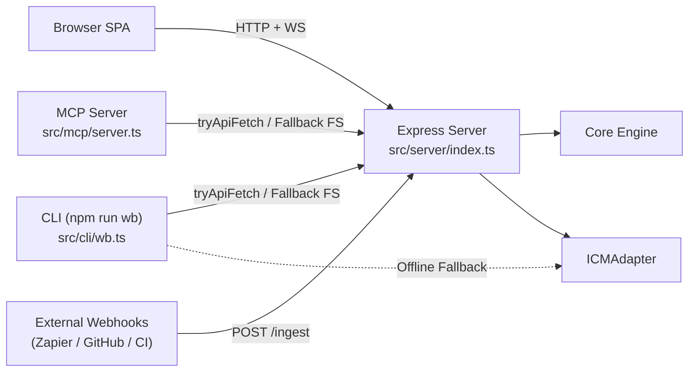

# Scrappy Whiteboard — API, CLI & Developer Experience (DX)

> **Parent Map:** [ARCHITECTURE.md](../ARCHITECTURE.md)  
> **Primary Source Files:** [src/server/index.ts](../src/server/index.ts), [src/cli/wb.ts](../src/cli/wb.ts), [src/mcp/server.ts](../src/mcp/server.ts)

---

## 1. Overview

Scrappy exposes a unified backend surface designed for both browser clients and programmatic/agentic integrations:
- **REST API v1 (`/api/v1/*`)**: Express HTTP endpoints for board CRUD, batch graph mutations (`GraphOp[]`), spatial context slicing, prompt submission/resolution, webhook ingestion, and ICM pipeline management.
- **Antigravity CLI (`npm run wb`)**: Command-line wrapper that targets the live REST API when running, and falls back to direct `ICMAdapter` disk operations when offline.
- **MCP Server (`npm run mcp`)**: Model Context Protocol (`@modelcontextprotocol/sdk`) stdio server exposing whiteboard tools to external AI agents.

---

## 2. REST API v1 Reference (`src/server/index.ts`)

All `:name` board parameters are validated by `app.param('name')` using `isValidBoardSlug(name)` (`1–64` alphanumeric, `-`, `_`; rejects `..`, `/`, spaces with `HTTP 400`).

### 2.1 Board Management
| Method & Path | Purpose | Key Request Fields | Response |
| :--- | :--- | :--- | :--- |
| `GET /api/v1/boards` | List all boards on disk | — | `{ boards: BoardSummary[] }` |
| `POST /api/v1/boards` | Create or clone a board | `{ name, title?, template?, cloneFrom? }` | `201 { board }` |
| `POST /api/v1/boards/:name/duplicate` | Duplicate existing board | `{ targetName?, title? }` | `201 { board }` |
| `POST /api/v1/boards/:name/reload` | Force reload board from ICM disk files | — | `{ board }` |
| `DELETE /api/v1/boards/:name` | Delete non-default board (`launch-plan` protected) | — | `{ success: boolean }` |
| `GET /api/v1/boards/:name` | Get full board state & active presence | — | `{ board, collaborators }` |

### 2.2 Graph Mutations, Context & Export
| Method & Path | Purpose | Key Request / Query Fields | Response |
| :--- | :--- | :--- | :--- |
| `GET /api/v1/boards/:name/context` | Extract token-budgeted `SpatialContextSlice` | `?selected=true&sectionId=...&bbox=x,y,w,h` | `{ slice }` |
| `POST /api/v1/boards/:name/ops` | Apply batch of `GraphOp[]` mutations & broadcast delta | `{ operations: GraphOp[], actorId?, autoLayout? }` | `{ board, version }` |
| `GET /api/v1/boards/:name/export` | Synthesize board or section to Markdown or Mermaid | `?format=markdown\|mermaid&sectionId=...` | `{ format, content }` |
| `GET /api/v1/boards/:name/files` | List ICM Option A files & previews for Glass-Box Drawer | — | `{ boardDir, files }` |

### 2.3 Prompts, Ingestion & Presence
| Method & Path | Purpose | Key Request Fields | Response |
| :--- | :--- | :--- | :--- |
| `POST /api/v1/boards/:name/prompts` | Queue `@scrappy` prompt (`icm` mode) or execute LLM (`standalone_api`) | `{ prompt, mode?, executionRoute?, selectedPipelineId?, anchorPosition?, targetNodeId?, selectedNodeIds?, selectedSectionId?, boundingBox?, apiConfig? }` | `201 { prompt, board }` |
| `POST /api/v1/boards/:name/prompts/:promptId/resolve` | Mark prompt completed (with optional `runInstantFallback`) | `{ summary?, runInstantFallback? }` | `{ prompt, board }` |
| `POST /api/v1/boards/:name/ingest` | Idempotent webhook ingestion into `data_card` nodes (keyed by `externalId`) | `{ source?, externalId?, title?, body?, structuredData?, status?, url?, sectionId? }` | `201 { board }` |
| `POST /api/v1/boards/:name/presence` | Announce agent/CLI presence cursor & status text | `{ actorId?, name?, role?, color?, cursor?, statusText? }` | `{ ok: true, collaborators }` |

### 2.4 Auth, Security & ICM Architect
| Method & Path | Purpose | Key Request / Query Fields | Response |
| :--- | :--- | :--- | :--- |
| `POST /api/v1/auth/token` & `/api/v1/boards/:name/auth` | Exchange passcode for signed HMAC capability token (+ optional Ably `TokenRequest`) | `{ boardName?, passcode?, actorId?, role? }` | `{ ok, boardName, actorId, token, mode, capabilities, transport, hasAbly, ablyTokenRequest }` |
| `POST /api/v1/boards/:name/security` | Toggle board `public` vs `passcode` protection | `{ mode, passcode?, allowedGroups? }` | `{ ok, security: { mode, hasPasscode } }` |
| `GET /api/v1/realtime/info` | Transport diagnostics (`ws` vs `federated`) | — | `{ transport, hasAbly, collaboratorCount }` |
| `GET /api/v1/boards/:name/icm/pipelines` | List `CONTEXT.md` routing & registered pipelines | `?prompt=...` (returns `matchedPipelines`) | `{ icmWorkspace, matchedPipelines }` |
| `POST /api/v1/boards/:name/icm/build-pipeline` | Compile canvas brainstorm into ICM pipeline | `{ pipelineId?, title?, description?, triggerIntents?, sectionId?, nodeIds?, outputWidgetType?, reflectOnCanvas? }` | `201 { compiled, board }` |
| `POST /api/v1/boards/:name/icm/walk-test` | Run Cold-Agent Walk Test verification | — | `{ walkTest }` |

---

## 3. Antigravity CLI (`src/cli/wb.ts`)

Invoked via `npm run wb -- <subcommand> [flags]`. Uses `WB_API_URL` (default `http://localhost:3000/api/v1`) and falls back to `ICMAdapter` on `boards/` if the server is unreachable.

- **Context & Prompts:** `context`, `prompts`
- **Canvas Mutations:** `add-node`, `delete-node`, `connect`, `update-edge`, `layout`, `presence`
- **Prompt Resolution:** `update-scrappy`, `resolve-prompt`
- **Export & ICM:** `export`, `pipelines`, `build-pipeline`, `walk-test`

> **Permission Rule:** Always invoke `npm run wb -- ...` as a single prefix-matchable command (no `&&`, `;`, or `$(...)`) so `.gemini/settings.json` allowlists auto-approve commands cleanly.

---

## 4. Model Context Protocol (`src/mcp/server.ts`)

Runs over `StdioServerTransport` (`npm run mcp`) and exposes three tools:
1. `wb_get_context`: Returns `SpatialContextSlice` for `{ boardName, selectedOnly, sectionId }`.
2. `wb_mutate_batch`: Validates `{ operations, autoLayout }` against `GraphOpsBatchSchema` / `AutoLayoutKindSchema` and applies mutations via REST or direct `ICMAdapter` fallback.
3. `wb_export_doc`: Exports `{ boardName, format: 'markdown' | 'mermaid', sectionId }`.

---

## 5. Planned API & DX Evolution

1. **Router Decomposition:** Split `src/server/index.ts` into domain routers under `src/server/routes/` (`boards.router.ts`, `ops.router.ts`, `prompts.router.ts`, `ingest.router.ts`, `icm.router.ts`) plus `src/server/auth.ts`.
2. **Runtime Boundary Validation:** `POST /api/v1/boards/:name/ops` validates payloads with `OpsBatchRequestSchema` (returning structured `400` errors on invalid operations). Next: add Zod request body schemas to `/prompts` and `/ingest`.
3. **OpenAPI 3.1 & Typed SDK:** Publish an OpenAPI spec at `/api/v1/docs` and extract shared API/CLI client logic into a typed `@scrappy/sdk` package.
4. **Production Security Hardening:** Enforce non-default `SCRAPPY_AUTH_SECRET` when `NODE_ENV === 'production'`, migrate passcode hashing to `crypto.scrypt`, and scrub client-supplied API keys from logs.
