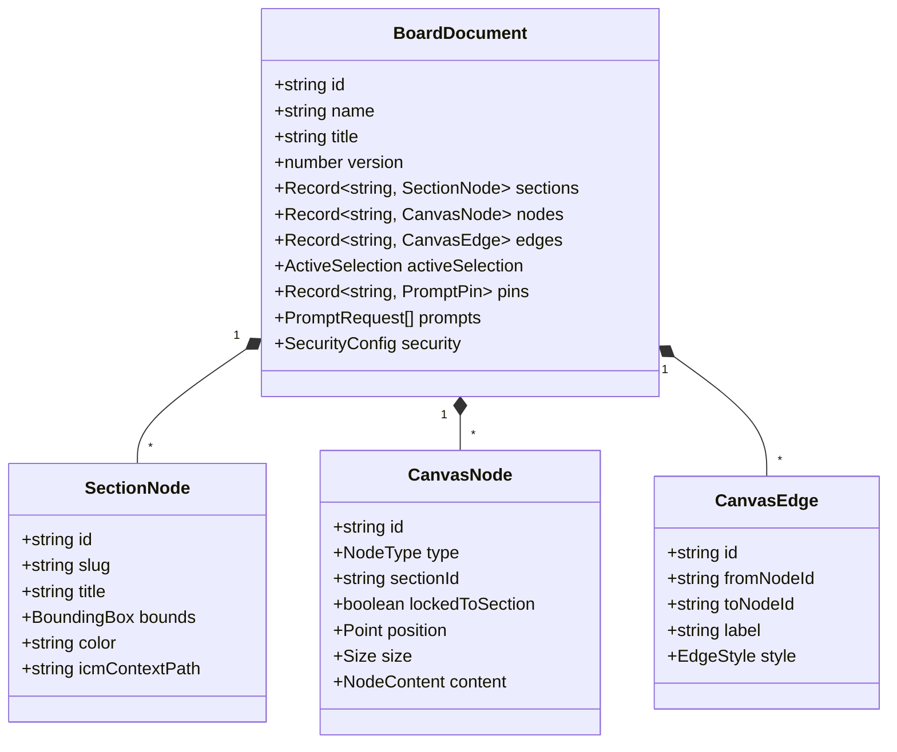

# Scrappy Whiteboard — Core Graph Engine & Domain Model

> **Parent Map:** [ARCHITECTURE.md](../ARCHITECTURE.md)  
> **Primary Source Files:** [src/core/index.ts](../src/core/index.ts), [src/core/types.ts](../src/core/types.ts), [src/core/reducer.ts](../src/core/reducer.ts), [src/core/validation.ts](../src/core/validation.ts)

---

## 1. Overview

`src/core/` is the pure, framework-agnostic domain layer shared across the Express server, React client, CLI (`wb.ts`), MCP server, and `ICMAdapter`. It defines the canonical `BoardDocument` model, deterministic `GraphOp` reducer, spatial slicing, auto-layout, synthesis, Zod validation schemas, and path-slug security helpers.

---

## 2. Canonical Domain Model (`src/core/types.ts`)

### Supported `NodeType` Values
`sticky` | `shape` | `text` | `checklist` | `mermaid` | `table` | `image` | `svg_graphic` | `suggestion` | `data_card`

### Supported `GraphOp` Mutations
- **Nodes:** `create_node`, `update_node`, `delete_node`, `accept_suggestion`
- **Edges:** `create_edge`, `update_edge`, `delete_edge`
- **Sections:** `create_section`, `update_section`, `delete_section`
- **Selection & Layout:** `set_selection`, `auto_layout`

---

## 3. Modular Domain Architecture (`src/core/`)

The core domain is decomposed into single-responsibility modules (re-exported via [src/core/index.ts](../src/core/index.ts) and the backward-compatible [src/core/engine.ts](../src/core/engine.ts) facade):

| Module | Responsibility | Key Exports |
| :--- | :--- | :--- |
| [reducer.ts](../src/core/reducer.ts) | Deterministic graph mutation & section containment | `applyOperations`, `findContainingSection` |
| [layout.ts](../src/core/layout.ts) | Spatial auto-layout (`grid`, `flowchart-lr`, `flowchart-tb`, `sections`) | `computeAutoLayout` |
| [slicing.ts](../src/core/slicing.ts) | Token-disciplined spatial context extraction (2k–8k budget) | `extractSpatialSlice` |
| [synthesis.ts](../src/core/synthesis.ts) | Board/section export to Markdown docs & Mermaid flowcharts | `synthesizeBoardToMarkdown`, `synthesizeBoardToMermaid` |
| [markdown.ts](../src/core/markdown.ts) | Lossless Markdown checklist & pipe-table round-tripping | `formatChecklistToMarkdown`, `extractChecklistFromMarkdown`, `formatTableToMarkdown`, `extractTableFromMarkdown` |
| [tableStyles.ts](../src/core/tableStyles.ts) | Natural-language CSS preset & theme resolver for `TableWidget` | `ResolvedTableStyle`, `resolveTableStyles` |
| [templates.ts](../src/core/templates.ts) | Starter board factories (`default`, `clean`, `pipeline`, `retrospective`) | `createDefaultBoard`, `createEmptyBoard`, `createBoardFromTemplate` |
| [security.ts](../src/core/security.ts) | Board slug validation & filesystem path-safe slugification | `isValidBoardSlug`, `sanitizePathSlug`, `slugify` |
| [validation.ts](../src/core/validation.ts) | Runtime Zod schemas & validator helper for `GraphOp` and `/ops` requests | `GraphOpSchema`, `GraphOpsBatchSchema`, `OpsBatchRequestSchema`, `validateGraphOpsBatch`, `NodeTypeSchema` |

---

## 4. Boundary Integration Status

- `OpsBatchRequestSchema` and `validateGraphOpsBatch` from [validation.ts](../src/core/validation.ts) are wired into `POST /api/v1/boards/:name/ops` ([src/server/index.ts](../src/server/index.ts)), `wb_mutate_batch` ([src/mcp/server.ts](../src/mcp/server.ts)), `RealtimeBus.handleInboundAblyMessage` ([src/realtime/bus.ts](../src/realtime/bus.ts)), and `smartAgent.ts` LLM response parsing ([src/server/smartAgent.ts](../src/server/smartAgent.ts)).
- **Next:** Add Zod validation on inbound WebSocket `op.delta` client messages when `/ws` transitions to bidirectional delta writes.
