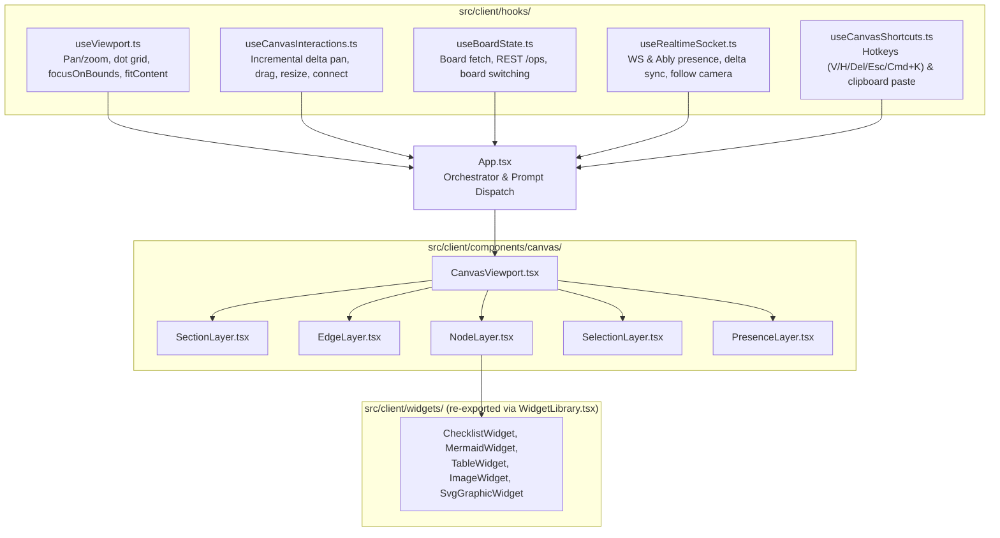

# Scrappy Whiteboard — Frontend UI & Canvas Interaction

> **Parent Map:** [ARCHITECTURE.md](../ARCHITECTURE.md)  
> **Primary Source Files:** [src/client/App.tsx](../src/client/App.tsx), [src/client/hooks/](../src/client/hooks/), [src/client/components/](../src/client/components/), [src/client/widgets/](../src/client/widgets/)

---

## 1. Overview

The frontend SPA (React 18 + Vite + TypeScript) renders a hardware-accelerated infinite whiteboard combining:
- An **HTML5 `<canvas>`** infinite dot-grid background.
- A **CSS-transformed world container** (`translate(x, y) scale(zoom)`) housing Scope Sections, SVG Bezier edges, interactive Widget cards, selection overlays, and live peer cursors.
- Glassmorphic **Shell UI** (`TopBar`, `BottomDock`, `GlassBoxDrawer`) and **Contextual Overlays** (`ScrappyContextDialog`, `ConnectorInspector`, `Modals`).

---

## 2. Viewport, Panning & Smart Placement

### 2.1 Camera & Dot-Grid Safety (`useViewport.ts`, `CanvasViewport.tsx`)
- **Safe Transforms:** `CanvasViewport` and `useViewport` sanitize `viewport.x`, `viewport.y`, and `viewport.zoom` with `Number.isFinite` guards so invalid CSS transforms (`NaNpx`) cannot blank the world container.
- **Dot Grid Modulo Math:** `useViewport` clamps `step = Math.max(8, 32 * safeZoom)` and uses positive modulo `((safeX % step) + step) % step` so negative pan coordinates render seamlessly without infinite loops.
- **Camera Focusing (`focusOnBounds`, `fitContent`):** Automatically centers and scales the camera onto newly created sections or nodes (and supports framing all board content).

### 2.2 Interaction State Machine (`useCanvasInteractions.ts`)
- **Incremental Delta Panning:** Tracks frame-to-frame pointer deltas (`effectivePanPosRef`) with single-frame sanity bounds (`< 1500px`) instead of frozen drag-start snapshots, preventing large coordinate jumps.
- **Window-Level Safety Listeners:** Attaches `window` `mousemove` and `mouseup` listeners while any drag/pan/resize/marquee interaction is active, and auto-aborts immediately if `e.buttons === 0`.
- **Target Filtering:** Distinguishes interactive controls (`input`, `textarea`, `button`, `select`, `[contenteditable="true"]`) and node/header handlers (`e.stopPropagation()` on cards/headers) from empty canvas or translucent section background clicks so panning works reliably everywhere.

### 2.3 Nearest-Space Placement (`src/client/utils/geometry.ts`)
- `findNearestAvailablePosition(center, width, height, existingSections, margin)` computes the user's visible viewport center in board coordinates (`screenToBoard`).
- Places new Scope Sections directly at the view center if unoccupied, or selects the closest non-overlapping adjacent candidate (right, below, left, above) using `doBoundsOverlap`, followed by `focusOnBounds()`.

---

## 3. Widget Library & XSS Protection (`src/client/widgets/`)

Each widget lives in its own module under `src/client/widgets/` and is re-exported through the backward-compatible [WidgetLibrary.tsx](../src/client/widgets/WidgetLibrary.tsx) barrel:

| Widget | File | Node Type | Key Capabilities & Security |
| :--- | :--- | :--- | :--- |
| `ChecklistWidget` | [ChecklistWidget.tsx](../src/client/widgets/ChecklistWidget.tsx) | `checklist` | Interactive toggle items, inline add/edit, "Action Open w/ @scrappy" trigger. |
| `MermaidWidget` | [MermaidWidget.tsx](../src/client/widgets/MermaidWidget.tsx) | `mermaid` | Renders flowcharts/diagrams with `mermaid` (`securityLevel: 'strict'`) + `DOMPurify.sanitize`. |
| `TableWidget` | [TableWidget.tsx](../src/client/widgets/TableWidget.tsx) | `table` | Inline spreadsheet editing, Markdown round-tripping, natural-language CSS theme styler. |
| `ImageWidget` | [ImageWidget.tsx](../src/client/widgets/ImageWidget.tsx) | `image` | Image card display and clipboard paste (`Cmd+V`) / upload support. |
| `SvgGraphicWidget` | [SvgGraphicWidget.tsx](../src/client/widgets/SvgGraphicWidget.tsx) | `svg_graphic` | Renders vector graphics sanitized via `DOMPurify.sanitize(..., { USE_PROFILES: { svg: true, svgFilters: true } })`. |

### 3.1 Modal Dialogs (`src/client/components/overlays/modals/`)

Overlay modals are split into single-responsibility modules under `src/client/components/overlays/modals/` and re-exported through [Modals.tsx](../src/client/components/overlays/Modals.tsx):
- [EditNodeModal.tsx](../src/client/components/overlays/modals/EditNodeModal.tsx)
- [PipelineStudioModal.tsx](../src/client/components/overlays/modals/PipelineStudioModal.tsx)
- [NewBoardModal.tsx](../src/client/components/overlays/modals/NewBoardModal.tsx)
- [DuplicateBoardModal.tsx](../src/client/components/overlays/modals/DuplicateBoardModal.tsx)
- [ShareSecurityModal.tsx](../src/client/components/overlays/modals/ShareSecurityModal.tsx)
- [PasscodePromptModal.tsx](../src/client/components/overlays/modals/PasscodePromptModal.tsx)

---

## 4. Planned UI & Modularity Evolution

1. **Split `TopBar.tsx` (808 lines):** Extract inline dropdown popovers into `BoardMenu.tsx`, `ViewMenu.tsx`, and `PresenceMenu.tsx` under `src/client/components/shell/menus/`.
2. **Agent Staging / Diff UX:** Introduce a non-destructive "ghost" preview state for AI-generated cards/edges so human users can Accept (`Cmd+Enter`) or Reject (`Esc`) agent proposals before committing.
