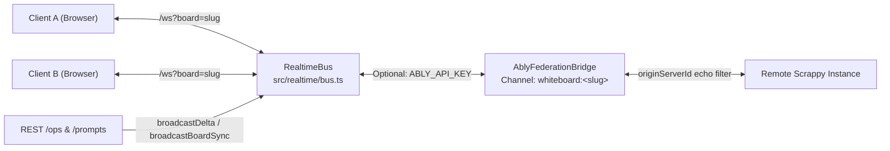

# Scrappy Whiteboard — Real-Time & WebSockets

> **Parent Map:** [ARCHITECTURE.md](../ARCHITECTURE.md)  
> **Primary Source Files:** [src/realtime/bus.ts](../src/realtime/bus.ts), [src/realtime/ablyBridge.ts](../src/realtime/ablyBridge.ts), [src/realtime/types.ts](../src/realtime/types.ts), [src/client/hooks/useRealtimeSocket.ts](../src/client/hooks/useRealtimeSocket.ts)

---

## 1. Overview

Scrappy supports multi-user collaboration and live agent presence through a dual-transport messaging layer:
1. **Native WebSocket Server (`/ws`)**: Zero-dependency `ws` server attached to the Express HTTP server via `RealtimeBus`.
2. **Ably Cloud Federation (`AblyFederationBridge`)**: Optional multi-region pub/sub bridge activated when `ABLY_API_KEY` is configured (`TransportMode`: `'ws'` vs `'federated'`).

---

## 2. Connection Lifecycle & Authentication (`src/realtime/bus.ts`)

1. Client connects to `ws(s)://<host>/ws?board=<slug>&token=<token>&passcode=<passcode>`.
2. `RealtimeBus` validates `board` via `isValidBoardSlug(boardName)` (closes with code `1008` if invalid).
3. `validateConnectionHandler` (wired in `src/server/index.ts`) checks `board.security.mode`:
   - If `'public'`, connection is allowed immediately.
   - If `'passcode'`, verifies either the HMAC-signed `token` (`verifyToken`) or SHA-256 `passcode` hash; rejects unauthorized clients with WS close code `1008`.
4. Socket is registered in `clientsByBoard` and `socketMeta`, and immediately receives `presence.sync` with the active collaborator roster.
5. On `close`, `RealtimeBus` removes the socket, deletes the actor from `presenceByBoard`, and broadcasts `presence.leave` + `presence.sync` for instant ghost elimination.

---

## 3. Message Envelope Specification (`src/realtime/types.ts`)

| Envelope `type` | Direction | Payload Shape | Purpose |
| :--- | :--- | :--- | :--- |
| `join` | Client $\to$ Server | `{ type: 'join', boardName, actorId }` | Associates `actorId` with the WebSocket connection. |
| `board.sync` | Server $\to$ Client | `{ boardName, board, source, originServerId? }` | Full `BoardDocument` snapshot (disk reload, template reset, pipeline build). |
| `op.delta` | Server $\to$ Client | `{ boardName, actorId, version, operations: GraphOp[], source?, originServerId? }` | Lightweight delta batch broadcast after REST `/ops` or Ably inbound delta. |
| `presence.update` | Bidirectional | `{ boardName, presence: CollaboratorPresence, originServerId? }` | Cursor `{ x, y }`, camera `viewport`, `name`, `color`, `role`, `activeNodeId`, `statusText`. |
| `presence.sync` | Server $\to$ Client | `{ boardName, collaborators: CollaboratorPresence[], originServerId? }` | Full room collaborator roster. |
| `presence.leave` | Server $\to$ Client | `{ boardName, actorId, originServerId? }` | Immediate removal of disconnected peer cursor. |
| `agent.activity` | Server $\to$ Client | `{ boardName, actorId, statusText, timestamp, originServerId? }` | Streams agent status entries to the Glass-Box Drawer. |

---

## 4. Client Real-Time Hook (`src/client/hooks/useRealtimeSocket.ts`)

- Manages WebSocket connection/reconnection, token persistence, and `presence.update` throttling (~40ms / 25fps).
- Implements **Follow Teammate** camera sync: clicking a peer's avatar in `TopBar` sets `followingActorId`, syncing the local viewport to the followed peer's `presence.update` viewport/cursor until the user manually pans or exits follow mode.
- Applies incoming `op.delta` messages directly onto local React state via `applyOperations` without triggering full board reloads.

---

## 5. Ably Federation & Echo Prevention (`src/realtime/ablyBridge.ts`)

- Each server instance generates a unique `originServerId` (`srv-...`).
- Outbound messages published to Ably channel `whiteboard:<boardName>` include `originServerId`.
- `AblyFederationBridge` drops inbound messages whose `originServerId` matches the local server's ID, preventing infinite pub/sub echo loops while forwarding remote server deltas to local WebSocket clients and `onRemoteDeltaHandler`.

---

## 6. Planned Real-Time Evolution

1. **Bidirectional `op.delta` over WebSocket:** Allow clients and agents to send `op.delta` directly over `/ws` (in addition to HTTP `POST /ops`) with client sequence IDs and server acknowledgments to remove HTTP round-trip overhead during high-frequency interactions.
2. **Optimistic Concurrency Control:** Enforce `baseVersion` / `expectedVersion` checks on incoming mutation batches to detect and resolve conflicting concurrent edits between multiple humans and agents.
3. **Structured WS Error Telemetry:** Log and surface malformed WS message errors rather than silently swallowing JSON parse failures.
